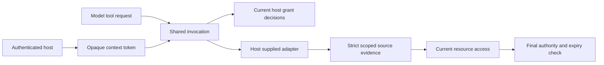

# Shared IXO agent tool contracts

`@ixo/agent-tools` supplies one set of read tool contracts for future QiForge native tools and MCP connectors. It does not register tools in the runtime or connect to IXO services. The Workers runtime remains unchanged.

## Authority belongs to the host

The host authenticates the user, verifies delegations and room access, and binds immutable context to an opaque token. The package accepts only tokens issued by that host. The model supplies a known tool name and strict arguments. It cannot select identity, network, oracle, room, session, audience, timezone, storage namespace or endpoint.

Grant readers return current decisions verified by the integrating host. This package validates their shape and context binding. It does not verify raw UCAN proofs. Discovery is advisory. Invocation reads grants before retrieval, after retrieval and after resource checks, immediately before disclosure. Errors, revocation and expired decisions suppress the value.

## One catalog owns the contract

Private Zod schemas define the ten tools, input and value shapes, allowed evidence sources, disclosure policy and freshness limits. The public catalog contains frozen data. Native and MCP descriptions derive their argument schemas from that catalog. Neither description registers a tool or imports a transport SDK.

The package root exports the host factory, catalog, version constants and two description generators. Other package subpaths are closed. The package depends only on Zod at runtime. Service clients and credentials belong to later adapters.

## Responses remain local to an invocation

There is no grant or response cache. The package takes an owned snapshot of adapter results before awaiting further authority checks. Source scope and grants bind all seven context fields, including visibility and timezone. A cached result returned by an adapter must still match that context and pass fresh evidence and authority checks.

Files require exact source, reference and revision receipts. The package derives an absence claim only from complete VFS and attachment coverage. Credit amounts remain exact decimal strings, and zero requires an explicitly confirmed lookup. Personal memory and oracle knowledge have different tools and evidence sources. Memory cannot substitute for live account evidence. Quotes need a host-reviewed adapter descriptor and matching inputs, current evidence and expiry. None of the tools executes a financial action.

## Version migration is explicit

The package starts at `0.1.0`. Its catalog is `1.0.0` and its source envelope is version `1`. The earlier design foundation remains a frozen `0.2.0-proposed` reference, rather than a second production implementation.

Compared with that reference, adapters must supply a versioned strict envelope and include visibility and timezone in both source scope and current grants. The quote adapter carries its review assertion beside its function. File responses may include an optional `absenceConfirmed` boolean, but the package ignores that value and derives its own. See the [package contract and migration reference](../../packages/agent-tools/README.md).

## Design selection

Two designs were compared before implementation. A host dispatcher with opaque tokens was selected over a per-session capability object. The token design gives an explicit refusal for foreign-host tokens and retains a single invocation path. Adding both APIs would give integrations two ways to carry authority. The selected design also specifies copied source data, final expiry checks and the envelope migration.

The implementation uses boundary validation and a schema-derived catalog. These choices apply Boundary Discipline and Model the Domain. The package test applies Prove It Works by installing its actual tarball in an isolated consumer and executing an invocation in workerd.

## Verification and remaining gates

Package tests exercise the ten read tools and refusal cases. The package artifact check tests denied deep imports, public exports, production dependencies and packed contents. Negative controls confirm that forbidden exports and dependencies fail the check. The same command bundles the installed tarball for the browser platform and runs it in real workerd with Node compatibility flags disabled.

The Workers harness CI job runs build, typecheck, behavior tests and the package artifact check. These checks establish the local contract. They do not establish live service connectivity, model intent acceptance or production readiness. Later stages supply service adapters, native registration, Companion guidance, MCP ingress and recorded intent evaluations. Merge, publication to npm and deployment remain separate release actions.
