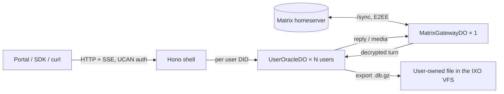

# @ixo/oracle-runtime-workers

Run a QiForge oracle on **Cloudflare Workers** — no server, no disk, no Redis.
The same plugin API, wire protocol and UCAN auth as `@ixo/oracle-runtime`,
re-hosted on Durable Objects. This is the only maintained runtime: the Node
runtime is deprecated, and what differs from it is in
[node-parity](docs/node-parity.md). Bounded semantic Decisions are included too, and
can run on Workers AI through the `AI` binding instead of account credentials
(see [configuration](docs/configuration.md#decisions)).

```ts
// src/index.ts of your oracle Worker
import { createOracleWorker, WeatherPlugin } from '@ixo/oracle-runtime-workers';

const oracle = createOracleWorker({
  config: { name: 'My Oracle', org: 'IXO', description: '…' },
  plugins: [new WeatherPlugin()],
  // Optional, as on Node: retune a loaded plugin's manifest without forking it.
  manifestOverrides: { weather: { visibility: 'always' } },
});

export const { UserOracleDO, MatrixGatewayDO } = oracle;
export default oracle; // { fetch, scheduled }
```

Deploying is `wrangler deploy` with two Durable Object bindings and a
handful of secrets. [`apps/qiforge-workers-example`](../../apps/qiforge-workers-example)
is the complete, runnable reference: the single-script `wrangler.jsonc` for
local development, the two-script devnet configs, `.dev.vars.example`, and
the test suites.

## How it works

One Worker deployment = one oracle.



- **`UserOracleDO`** — one per user DID. The user's SQLite database
  (checkpoints, sessions, transcript) lives in Durable Object storage behind
  wa-sqlite; the object runs the agent turn and streams SSE itself.
- **`MatrixGatewayDO`** — one per oracle. A subclass of `MatrixBotDO` from
  [`@ixo/matrix-bot-workers-sdk`](https://www.npmjs.com/package/@ixo/matrix-bot-workers-sdk),
  which owns the bot identity, E2EE, the sync loop, paced durable sends,
  catch-up after a restart and device rotation. The subclass adds the
  oracle parts: room messages → user turns, room ↔ user routing, snapshot
  media, the account-room secrets key, the plugins' second device.
- **The user owns the file.** The object holds a working copy; the durable
  file is `/.oracles/<oracleDid>/state.db.gz` in the user's IXO VFS,
  exported on a debounced alarm and re-imported on a cold boot. The oracle
  reaches it with the one delegation the user deposits for it
  (`POST /delegation`), which must carry `ixo:filesystem/.oracles` next to
  the plugin grants and must expire (a delegation with no expiry is refused)
  — see [architecture](docs/architecture.md#self-sovereign-storage).
- **Two scripts in production.** The gateway runs in its own Worker script
  so its memory footprint never competes with user objects; the scripts
  talk over cross-script Durable Object bindings.

## Deploy in five steps

1. Copy the example's `wrangler.gateway.<env>.jsonc` and
   `wrangler.<env>.jsonc`; set the names, `ORACLE_DID`, `ORACLE_ENTITY_DID`,
   `MATRIX_*` vars and the plugin URLs.
2. Deploy the gateway script, then its secrets
   (`MATRIX_ORACLE_ADMIN_PASSWORD`, `MATRIX_RECOVERY_PHRASE`,
   `MATRIX_VALUE_PIN`).
3. Deploy the oracle script with its secrets (`OPEN_ROUTER_API_KEY`, the
   same Matrix secrets, and `ORACLE_SIGNING_MNEMONIC` unless the account
   room already holds the mnemonic the Node runtime or the CLI provisioned —
   then the runtime reads it from there).
4. `POST /matrix/start`, then `GET /matrix/status` until `running` and
   `cryptoReady` are true.
5. Run the feature matrix against it (see [testing](docs/testing.md)).

Every variable, binding and migration is explained in
[configuration](docs/configuration.md).

## Operate

| Route                                                 | Purpose                                               |
| ----------------------------------------------------- | ----------------------------------------------------- |
| `GET /health`, `GET /health/matrix`                   | Liveness; the gateway's health (503 when not running) |
| `GET /matrix/status`, `POST /matrix/start`            | Gateway status and start                              |
| `POST/GET /sessions`, `POST/GET /messages/:id`        | The chat API                                          |
| `GET /runs/:runId`, `GET /sessions/:id/messages`      | Re-join a durable run; one page of a transcript       |
| `GET /sessions/:id/run`, `GET /runs/active`           | A session's active run; every active run of the user  |
| `/delegation`, `/models`, `/socket.io/`, `/byo-llm/*` | Delegation, models, realtime channel, BYO LLM         |
| `POST /channels/turn`                                 | IXO Channels ingress; refusals carry a `code`         |
| `POST /messages/:sessionId/:messageId/feedback`       | Anonymous feedback on a reply (when configured)       |
| `/topic-deliverables/:operationId`                    | Owner-only Topic deliverables (when enabled)          |
| `GET /a/:id`, `GET /a/:id/data`                       | Artefact links opened from chat apps (public)         |
| `GET/DELETE /artifacts/:id`                           | An artefact's canonical copy; revoke its link         |
| `/debug/*` (with `ORACLE_DEBUG_ROUTES=true`)          | Storage, tasks, sockets, outbox, gateway restart      |

The status fields, the runbook and the behaviour of both objects over their
lifetime are in [operations](docs/operations.md).

## Rich WhatsApp messages (for oracle authors)

On WhatsApp through IXO Channels, every oracle can send reply buttons, list
menus, link buttons and image cards. Nothing is configured per oracle, and the
same reply reads as normal text on Matrix, the Portal and any other client.

**When they are available.** Every channel turn result lists `rich_messages`
in `features`. A gateway that has seen it sends a `render` object with each
message turn: the element kinds it can show, the link-button labels it knows,
and the link origins its deployment approves (gateway configuration, not the
oracle's). Only then does the model get the tools below, plus a "Buttons in
this chat" prompt section placed after your own instructions. The first turn
after a runtime or gateway deploy is therefore plain text; the next ones are
rich.

| Tool               | Sends                                                                   | Limits (WhatsApp)                                                                          |
| ------------------ | ----------------------------------------------------------------------- | ------------------------------------------------------------------------------------------ |
| `offer_choices`    | A question with options: reply buttons, a list menu, or a numbered list | buttons: 2–3, title ≤ 20; list: ≤ 10 rows, title ≤ 24, description ≤ 72; body ≤ 1,024      |
| `send_link_button` | A message with one button that opens a link, optional header picture    | label from the fixed set; link on an approved origin; body ≤ 1,024                         |
| `send_cards`       | One image card, or a carousel of 2–10                                   | carousel card text (`*title*` + text) ≤ 160 with ≤ 2 line breaks; one link button per card |

- **Format selection** (the runtime picks): 2–3 options with short titles and
  no descriptions are buttons; up to 10 options, or any description, a list;
  anything else a numbered list. Nothing is ever cut. A call that misses
  buttons or a list only because a title or description is too long is sent
  back to the model once, naming each long title, so it can shorten them; the
  second call goes out as it is. A text that repeats the link is sent back
  once the same way.
- **Link buttons:** labels come only from a fixed set — `open` (Open),
  `allow` (Allow), `start_check` (Start check), `sign_in` (Sign in), `view`
  (View), `register` (View & register), `continue` (Continue). A link becomes
  a button only when its origin is on the gateway's approved list; otherwise
  it goes out as text with the link. Links are parsed once and only their
  normalised `href` is sent. Images are public https links WhatsApp fetches.
- **The reply ends** with a rich message: the model writes its lead-in first;
  nothing follows the buttons, card or link.
- **Taps** arrive as a normal turn: the option's title as the message, and a
  `choice` id (`oc:<offer>:<key>`) the runtime checks against the choices this
  session offered in the last 24 hours. The model reads a short note naming
  the question and the option. Typing an answer instead works as usual.
- **Other surfaces:** each rich part carries its text version — the numbered
  choices, `Label: url`, or each card's title, text, `Image: url` and
  `Label: url`. Matrix rooms, the Portal, the room mirror, quotes and the
  thread history show that text.

**From plugin code**, attach the same parts without the model: build them with
`linkButtonPart`, `choicesPart` or `cardsPart` against `renderOf(ctx)`, and
return them with `withRichParts(ctx, { name, content, parts })`. When a
builder returns no part (no `render`, a link not on an approved site), keep
your plain sentence with the link. A plugin's parts are delivered after the
model's reply and end it. The credentials plugin uses this for its permission
card (`allow`) and identity-check link (`start_check`). Details: [chat
delivery](docs/chat-delivery.md#rich-messages-buttons-lists-link-buttons-cards)
and the wire contract in [channels](docs/channels.md#rich-messages).

## Documentation

| Page                                                     | What it covers                                                                                                             |
| -------------------------------------------------------- | -------------------------------------------------------------------------------------------------------------------------- |
| [architecture](docs/architecture.md)                     | The objects, the gateway split, self-sovereign storage, cost model, workerd rules, tasks                                   |
| [node-parity](docs/node-parity.md)                       | What is identical to the Node runtime, what differs, what is Workers-only, what is not ported                              |
| [configuration](docs/configuration.md)                   | Wrangler config, migrations, every env var and binding, `createOracleWorker` options, setup                                |
| [operations](docs/operations.md)                         | Routes, status fields, gateway and user-object lifecycle, the ChatGPT proxy, the runbook                                   |
| [chat-delivery](docs/chat-delivery.md)                   | Chat replies on WhatsApp and Matrix: profiles, Reply Plans, artefacts, rich messages (buttons, lists, link buttons, cards) |
| [channels](docs/channels.md)                             | The IXO Channels ingress: authorization, retries, Reply Plans, Matrix continuity                                           |
| [frontend-bridge](docs/frontend-bridge.md)               | Browser tools and AG-UI actions over the socket: one invocation, one socket, unknown outcomes                              |
| [pod-creator](docs/pod-creator.md)                       | The POD Creator plugin: roles, state in `ctx.kv`, the create path and its launch gate                                      |
| [credentials](src/plugins/credentials/README.md)         | The credentials plugin: credential checks, the Hub's two permission cards, Self identity-check links; WhatsApp only        |
| [ixo-transaction](docs/ixo-transaction.md)               | The opt-in wallet-signing plugin: chain ids, signing outcomes, the mainnet receipt rule                                    |
| [action-proposals](docs/action-proposals.md)             | Action cards: a transfer prepared from chat, signed in the Portal, verified on chain, receipted                            |
| [topic-action-proposals](docs/topic-action-proposals.md) | Topic cards: discussion drafts and claim-access grants as multi-step journals with one-use permits                         |
| [chain-tools](docs/chain-tools.md)                       | The bundled `ixo-chain` reader: live balances, the 30 lookup kinds, names from the IXO Names worker, retries and limits    |
| [testing](docs/testing.md)                               | Unit, harness e2e, the devnet feature matrix, stress                                                                       |
| [load-tests](docs/load-tests.md)                         | Measurements and the findings that shaped the gateway                                                                      |

## Status (September 2026)

- Deployed on devnet as `mike-devnet-oracle` + `mike-devnet-oracle-gateway`
  and exercised by the full feature matrix and the 18-user stress run after
  the move to `@ixo/matrix-bot-workers-sdk`; 0.1.3 is the first release fit
  for production (0.1.0–0.1.2 could send plaintext into an encrypted room
  after a lazy-member sync delta, and queued session markers behind
  background replays — both fixed in 0.1.3 and re-measured, see
  [load-tests](docs/load-tests.md#session-creation-is-the-one-funnel));
  0.3.1 brings the streamed media calls the legacy-copy import and the
  attachments now use (a 50 MB Node-era checkpoint no longer resets the
  user object's isolate) and the crypto-snapshot flush before every keys
  upload.
- October 2026: the Node runtime was deprecated (pull request 330), and the
  Workers runtime gained the IXO Channels ingress, chat delivery with
  artefacts, request admission, supplied-context tasks and the Topic
  deliverable API, admin-plane tools, anonymous feedback, the POD Creator
  and ixo-transaction plugins (see the pages above and
  [node-parity](docs/node-parity.md#workers-only)).
- Observe-only domain context (off by default): the oracle's and the
  selected subject's anchored `domain.md` in the prompt, with provenance
  ([configuration](docs/configuration.md#domain-context-observe-only-rollout)).
- Open: the memory engine's recall ranking on accounts with a long history;
  the storage cost of task-holding users at scale (R2 page tier, see
  [architecture](docs/architecture.md#storage-cost-planning)).
- Not ported on purpose: the Slack transport and the commerce lane — see
  [node-parity](docs/node-parity.md#not-ported). Matrix group chats were
  ported in September 2026 behind `MATRIX_GROUP_ROOMS=gate` (the gate and
  channel memory run in the gateway; by default the bot stays silent in
  group rooms, see [operations](docs/operations.md#rooms-group-chats)).
