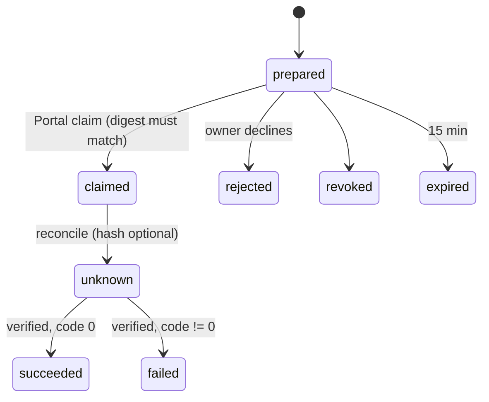

# Action proposals (validated action cards)

A conversational request for a native IXO or impact-credit transfer becomes a
sealed **action card**: an immutable proposal stored in the owner's
`UserOracleDO`, reviewed and signed by the owner in the Portal at a short
link, verified on chain by the runtime, and receipted back into the
conversation it came from. The oracle never signs, broadcasts or executes.

Off by default. `ACTION_PROPOSALS_ENABLED=true` switches the plugin and the
owner-object preparation path on; the routes, reconciliation, outcome polling
and receipt delivery stay available either way. Enabling it is a separate
operator action with the gates in IXO-5609 / IXO-5618.

Code: `src/action-proposals/` (store, policy, chain verifier, reconcile),
`src/plugins/action-proposals/` (the `prepare_action` tool and its evidence
rules), the `/action-proposals/*` routes in `src/shell/app.ts`, and the
contract in `@ixo/ixo-transaction/action-proposals`.

## Settings

| Variable                                                | Meaning                                                                                                                                                                                                                                                                                                                                                                    |
| ------------------------------------------------------- | -------------------------------------------------------------------------------------------------------------------------------------------------------------------------------------------------------------------------------------------------------------------------------------------------------------------------------------------------------------------------- |
| `ACTION_PROPOSALS_ENABLED`                              | `'true'` lets the `prepare_action` tool prepare cards. Default `'false'`.                                                                                                                                                                                                                                                                                                  |
| `ACTION_PROPOSALS_PORTAL_ORIGIN`                        | The trusted Portal origin the `/a/<id>` links point at: `https`, host only. Required when the feature is on; boot refuses the Worker otherwise.                                                                                                                                                                                                                            |
| `ACTION_PROPOSALS_RPC_DEVNET`, `…_TESTNET`, `…_MAINNET` | The chain RPC the verifier reads (`https`, no credentials, query or fragment; a base path such as `/rpc/` is fine). At least one of devnet or testnet is required when the feature is on. A card for a network with no RPC is refused at preparation; if the RPC is removed later, the alarm spends that card's verification attempts on the cooldown and stops after ten. |
| `IXO_TRANSACTION_CHAIN_ID_*`                            | Shared with the wallet-signing plugins ([ixo-transaction](ixo-transaction.md)): the chain id a card for each network must name.                                                                                                                                                                                                                                            |

`validateEnv` checks the three rules above at boot (`src/core/env.ts`), so a
misconfigured feature fails the deploy, not the first user.

## The card

The contract (`ActionProposalSubjectSchema`) binds the owner DID, the
originating session / run / tool invocation, the exact `sign_transaction`
inputs (one catalogue message), the signer, the single target, the network
and chain id, the evidence references, and an absolute expiry. Its digest is
the `ixo-json-v1` SHA-256 of the canonical subject, the same implementation
the Portal and the Decision module use. Lifecycle changes never change the
digest.

**The memo is the card id.** `inputs.memo` must equal the proposal id
(`ap_<uuid>`); the schema refuses anything else. The owner signs that memo
with the transfer, and the verifier accepts no transaction whose memo differs,
so one signed transaction can only ever confirm the one card it was signed
for. The store also keeps `(owner, transactionHash)` unique: a hash another
card already recorded is refused with a conflict.

**Policy in the owner object** (`src/action-proposals/policy.ts`), applied to
every card whichever plugin prepared it: the owner is the authenticated user,
the signer is the owner's own account, mainnet is refused, the chain id is the
one configured for the network, and the expiry is at most 15 minutes after
creation. A card asked for in a Matrix **group room** is refused (`Action
cards are prepared in direct chats only`): a card names one person's wallet
and its link and receipt would be visible to the whole room.

## Evidence before the model

`prepare_action` (`src/plugins/action-proposals/`) runs deterministic checks
over the user's own words (the last eight human messages, the runtime's
turn-time note stripped) before asking the `companion.action-intent` Decision
anything:

- the recipient appears as a whole address;
- the amount appears with its unit beside it (`1.5 IXO`, `1500000 uixo`,
  `10 credits`, `10 CARBON-1`): a bare number, a clock time, `5 uixo` for a
  request of 5 IXO, or `10` inside `CARBON-10` or `10.5` is not evidence;
- a credit token id appears as a whole token (`CARBON-1` is not evidence for
  `CARBON-10`);
- the latest message is not negated, hypothetical or quoted.

These checks are co-occurrence, not binding: the address, the amount with
its unit and the token id are each looked for anywhere in those messages, so
a balance mentioned two turns ago can satisfy a later request's amount. The
Decision below is the second gate for that, and the owner reads the sealed
card before signing.

Only then is the Decision asked whether the latest message requests exactly
this action; it sees the user's own figures (`requested: { amount, unit }`)
beside the atomic ones in the message, and must answer `requested` with
confidence and probability of at least 0.95 (provisional policy, not
calibrated accuracy). Anything else, a provider failure included, is a
clarification. The refusal reason is logged at warn
(`[action-proposals] preparation refused: …`); the user sees the owner
object's own words when the policy refused the card, a generic clarification
otherwise.

## Lifecycle

A claim consumes a prepared card once and atomically; a second device gets a
conflict. `reconcile` takes only an optional transaction hash and never a
claimed outcome. Verification (`src/action-proposals/verify.ts`) reads
`/status` and `/tx?hash=` from the configured RPC, requires the chain id, the
hash of the returned bytes, a signature, the memo and byte-exact message
bytes, and records height and result code.

Routes (`private, no-store`, owner UCAN): `GET /action-proposals/:id`,
`POST …/claim | reject | revoke | reconcile`. 2xx answers `{ proposal }`,
a refused command answers `409 { error }`. The `/a/<id>` link is an opaque
locator for the Portal and grants nothing.

## Background verification and receipts

The owner object's alarm (`tickActionProposals` in `user-oracle-do.ts`)
does three things. The tick is guarded and rows this build cannot read are
quarantined on first sight, so one bad row neither stops the flush, the tasks
and the eviction nor fails the tick again a minute later:

- **Verification**: at most two chain lookups per tick for cards that are
  `unknown` with a recorded hash, so a card the owner signed and then
  closed the browser on still gets confirmed once the chain has indexed
  it. The cooldown doubles from 30 s to 10 min and the alarm gives up after
  ten attempts (about an hour); a Portal reconcile still looks the hash up
  once the cooldown has passed. Two proofs end the wait early. A hash the
  verifier proved is **another transaction** (its bytes hash differently, or
  it carries another card's memo or none) is marked rejected: the owner may
  record the right hash with a later reconcile (`Transaction reference
already recorded` is refused only while the recorded hash is unproven) and
  it gets a fresh schedule. A transaction that carries **this card's memo but
  other messages** is the owner's card-bound effect gone wrong: the card gets
  `lifecycle.executionBlockedAt`, the hash stays listed and may not be
  replaced (`Execution is blocked`), verification stops and the card stays
  `unknown`; the owner prepares another. The reason is logged
  (`[action-proposals] <id> execution blocked: …`), never sent.
- **Receipts**: a verified card whose turn came from a Matrix thread or a
  channel is receipted into that thread (`<title> confirmed on chain.
Transaction … Block … Code …`) with a stable transaction id, at most four
  per tick. A failed post is retried with the same doubling cooldown up to an
  hour apart and **abandoned** after twelve attempts (about five hours);
  a receipt row whose card no longer parses or verifies is **quarantined**
  and logged (`[action-proposals] receipt <id> quarantined: …`). Cards from
  Portal-local sessions have no room and are marked `unavailable`.
- **Retention**: finished cards (succeeded, failed, rejected, revoked,
  superseded, or prepared and long expired) older than 90 days are deleted
  with their receipts; `/a/<id>` then answers 404. Claimed and unknown cards
  are kept.

Channel polls (`/channels/turn`) attach `actionOutcomes` for the proposals
of that authenticated owner's original session and run only, attempting at
most one verification per poll; the gateway turns them into WhatsApp
receipts ([channels](channels.md)).

## What is still open

Live gates recorded in IXO-5618: a real wallet round trip from the Portal,
a WhatsApp round trip through the gateway, the selected Jev provider
verified with a real call, duplicate-delivery and wallet-disconnect
recovery, and latency with mobile recordings. None of these can be inferred
from the unit suites in [testing](testing.md).
