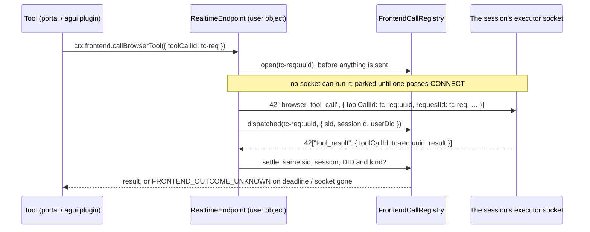

# Frontend bridge

How the runtime asks the user's browser to do something: a **browser tool**
(the Portal's `tools[]`, run through the Portal plugin) or an **AG-UI
action** (`agActions[]`, run through the AG-UI sub-agent). Both travel over
the realtime channel (`src/realtime/`, socket.io on the user object) and
share one contract, version 2, which the Portal's Topic conversation
commands depend on. The wire contract itself lives in
`@ixo/common/ai/frontend-bridge`, shared with the Node caller in
`@ixo/common`.

This page describes the Workers behaviour. It does not enable Topic writes
and does not change Topic Protocol 1.x persistence; the Portal keeps writes
disabled until its own gates pass (see "Rollout checks").

## The contract



- **One id per invocation.** The bridge, not the caller, makes the id
  unique: `<caller id>:<uuid>` (`frontendInvocationId`). The caller id stays
  readable as the prefix and is sent as `requestId`. An id is issued once;
  the registry refuses to open an id it holds as pending or remembers as
  finished.
- **Registered before it is sent.** The call is in the registry before the
  frame leaves, so an immediate answer cannot be missed.
- **Ownership is checked at CONNECT.** A socket serves a session only after
  its CONNECT packet's UCAN proved the DID the shell routed it for and the
  session exists in that user's own database. The user object is per DID
  and per oracle deployment, so the session belongs to this user and this
  oracle by construction. A failing ownership lookup refuses the socket
  (`Unauthorized: session check failed`) instead of leaving it half-open.
  `@ixo/oracles-client-sdk` renews its credentials (a fresh invocation,
  then a fresh delegation and invocation) only for a refusal of the
  credentials themselves; a failed session check, a failed auth check and
  a token of another user are final.
- **One socket per invocation.** The call goes to one authenticated socket
  of its session only, never to every tab (`SessionSocketHub.executorFor`):
  - a **foreground** socket first (any socket that did not declare itself
    a background executor: a tab showing the chat), the one with the most
    recent client-originated socket.io event (a result, `ping`, `status`,
    …; `lastActiveAt` on the socket attachment, so it survives
    hibernation). With no such event on any tab, the one that connected
    last runs it. A tab that connected last is often a background tab that
    reconnected after a laptop woke, so activity wins over connection
    order. engine.io pongs do not count: background tabs answer them too.
    A foreground socket runs any tool, whether or not it registered it;
  - without one, for a browser tool, a **background executor** that
    declared it (see
    [Executor kinds](#executor-kinds)), by the same recency;
  - with neither, the call is parked (see [Parked calls](#parked-calls)).
- **Results are bound to the socket.** A `tool_result` / `action_call_result`
  settles the invocation only when it arrives on the socket it was sent to:
  the same engine.io sid, session and authenticated DID, and the same kind.
  Each of these is rejected and logged, and the call keeps waiting:
  - a result from another tab of the same session;
  - a result from a reconnected tab, which has a new sid;
  - a result from another session's socket;
  - a payload `sessionId` naming a different session (a session override);
  - a browser-tool result for an AG-UI invocation, or the reverse.
- **One result per invocation.** A finished invocation is remembered. A
  duplicate, replayed or late result is rejected as `already settled`, and
  an id never issued as `not issued`. The records are bounded to 1,024 and
  30 minutes (`MAX_COMPLETED_FRONTEND_CALLS`,
  `COMPLETED_FRONTEND_CALL_TTL_MS`). Pending calls are never evicted to make
  room. Past 256 calls in flight per user (`MAX_PENDING_FRONTEND_CALLS`), a
  new call is refused instead, as never sent. Parked calls count toward the
  256: a user with many chats waiting for their tabs has fewer slots for
  sent calls.
- **Unknown, not failed.** When the answer of a sent call cannot arrive,
  the call resolves with the result below and is never sent again. This happens when the
  deadline passes, at once when the executing socket goes (closed, errored,
  dropped by the heartbeat, or a send to it failed), since only that socket
  could have answered, and at once when the turn aborts (Stop, the turn
  deadline). The plugins pass `ctx.abortSignal` as `FrontendCallParams.signal`.
  A turn aborted before the call was sent (parked, or not made yet)
  rejects it as `… was not sent: the turn was aborted`
  (`FrontendCallNotSentError`, see [Parked calls](#parked-calls)).

  ```json
  {
    "success": false,
    "code": "FRONTEND_OUTCOME_UNKNOWN",
    "outcome": "unknown",
    "invocationId": "tc-req:…",
    "message": "The frontend result did not arrive. The operation may still complete. Read command status using the original command ID before retrying; do not issue a replacement mutation."
  }
  ```

  The model receives it as the tool result. The Portal recovers the
  original command from its own journal by command id instead of issuing a
  replacement. A client that cannot tell whether its own write landed may
  answer `{ success: false, outcome: 'unknown' }`. That answer is also
  returned, not turned into an AG-UI rejection. On the SSE stream an AG-UI
  action with an unknown outcome ends as `action_call` `status: 'done'`,
  with the unknown result as its `output` and no `error`. A client that
  offers a retry on `status: 'error'` therefore does not offer one for an
  action that may have run. A browser tool's unknown result already ends as
  a `tool_call` `done`.

- **Explicit failures keep their contract.** A result with `error` rejects.
  An AG-UI `{ success: false, error }` rejects with that error. A browser
  tool's `{ success: false }` is its result.
- **Topic writes get a longer window.** `mutate_topic` waits 120 s
  (`TOPIC_MUTATION_TIMEOUT_MS`). Other browser tools wait 15 s and AG-UI
  actions 15 s.
- **Frontend call frames reach a socket only as invocations.** The router
  tap that mirrors turn events to sockets skips `browser_tool_call` and
  `action_call`. The SSE stream's own `action_call` frames (the AG-UI
  sub-agent's `isRunning` / `done`) and a plugin's one-way
  `ctx.emit.browserToolCall` / `actionCall` still reach the SSE stream, but
  no socket. A browser that executed them would act again. A browser tool
  invocation frame is also emitted to the session's SSE stream. An AG-UI
  invocation frame is not. The SSE stream already reports the action under
  the model's call id and closes it when the tool ends. A second frame
  under the invocation id would never be closed, and the client would show
  a card that spins forever.
- **Diagnostic logs carry identifiers only.** The `ixo.action.log` room
  event (`logFrontendAction`) records `args: {}` and a result of
  `{ invocationId, commandId?, outcome? }`. `commandId` is kept only when
  it is a 64-character hex digest; a free-form value could be user content.
  The realtime warnings name invocation ids, socket sids and sessions,
  never a payload.
- **Client-declared tools cannot shadow server tools.** A request-time tool
  whose name another tool of the turn already has is dropped for that turn,
  with one `[tool-registry] request tool "<name>" of plugin "<plugin>"
dropped …` warning. The server tool, or the first request tool of that
  name, stays, and the turn runs. Otherwise the model could call one tool
  while the runtime ran the other. Failing the turn instead would break
  every turn of a client release that declares a clashing name. The Portal
  and AG-UI plugins also keep only the first descriptor of a name declared
  twice in `tools[]` / `agActions[]`.
- **`/health` advertises the version.** It returns
  `frontendTools: { protocolVersion: 2, execution: 'single-socket', timeoutOutcome: 'unknown' }`
  (`FRONTEND_BRIDGE`). The Portal enables conversational writes only on
  exactly these values. The value is static: it signals the version and is
  not proof that a deployment behaves.

## Parked calls

A chat's browser tab can be gone while its turn runs: the Portal opens one
SDK socket per session and closes it when the user switches chats. A call
with no socket of its session that can run it is **parked**, not failed:

- It is registered as pending with no executor, and recorded per session
  in call order (`toolCallId`, kind, event, payload, session, tool,
  `parkedAt`). Nothing is sent: not to a socket, and not the SSE mirror of
  a browser-tool invocation, which is emitted when the call is actually
  sent.
- When a socket of that session passes CONNECT, every parked call it can
  run is sent to it, oldest first, right after its `connected` event: a
  foreground socket takes all of them, a background executor the browser
  tools it declared. From then the call is an ordinary invocation bound to that
  socket, with its own deadline (15 s, 120 s for `mutate_topic`, 15 s for
  the plugins' AG-UI actions) starting at the send.
- While parked, the call's clock is the park deadline
  (`FRONTEND_PARK_TIMEOUT_MS`, default 300 s, at most 2147483647). Past it
  the call rejects with `<Browser tool|AG-UI action> <tool> was not sent: no
browser joined session <id> within <n> s. Ask the user to open this chat;
do not retry on your own.` The turn's abort (Stop, a superseding message,
  the turn deadline `TURN_TIMEOUT_MS`) rejects it as `… was not sent: the
turn was aborted`. Both are a `FrontendCallNotSentError` (exported from
  `src/realtime/frontend-call-registry.ts`, `reason` `park-deadline` /
  `aborted`), a definite failure: the call never reached a browser, so the
  tool layer's `isUncertainOutcome` is false for it — checked before the
  turn's aborted signal, which would otherwise make every failure of an
  aborted turn uncertain — and a write tool's claim is released. The
  wording matches nothing the tool layer reads as uncertain either. A
  parked call is bound to no socket, so a socket going never ends it.
- After a park deadline the session is marked: its later calls fail at
  once, without parking, as `… was not sent: no browser has joined session
<id> since an earlier call waited <n> s for one. Ask the user to open this
chat; do not retry on your own.` (`reason` `no-browser`), so a model that
  calls again does not wait another full deadline. The mark is cleared
  when a socket of the session passes CONNECT; it is in memory, so it is
  also gone when the object hibernates (the next call then parks again).
  A call that a socket of the session can already run is sent as usual.
- The plugins no longer refuse a call when `hasClient` is false: the
  Portal and AG-UI plugins always call the bridge and let it park.
  `wallet-signing.ts` never parks (see [Wallet signing](#wallet-signing)).
- `ctx.frontend.parkedFor(sessionId)` returns the session's oldest parked
  call as `{ kind, toolName, since }`. The user object sets it as
  `waitingFor` on the run summaries of `GET /runs/active`,
  `GET /sessions/:id/run` and `activeRun` on `GET /sessions` rows, on the
  running (or recovering) run only, never persisted. A client shows the
  chat as waiting for the user; opening it mounts the chat's socket, whose
  CONNECT sends the call.
- `GET /debug/realtime` marks each pending call `parked: true|false` and
  counts `parkedCalls`. Log lines name the invocation id, session, socket
  sid and tool, never the payload.
- Browser tools and AG-UI actions declare `surface: 'frontend'`
  (`PluginTool`): the tool scheduler runs them in their session's own
  `frontend:<sessionId>` lane, one call at a time, never in the user-wide
  read or write lanes, so a call parked in one chat holds no slot another
  chat needs, whether it reads or writes. A sub-agent's dispatch lane is
  kept per session too (`subagent:<sessionId>`), so an AG-UI action parked
  inside its sub-agent holds only that chat's dispatch slots. A frontend
  write is still claimed in the write-claim ledger by its effect, under a
  fingerprint that names its session: the same browser action in two chats
  is two actions and never blocks the other.
- Every Portal browser tool runs in its session's lane, the ones that
  change shared data (`mutate_topic`) included. This is deliberate: a
  Portal shows one chat in the foreground at a time, so two chats' browser
  writes cannot run at once — the other chat's call is parked until its tab
  opens — and the Portal's own tools carry their guards (command journal,
  revisions) for what reaches them. Two Portal tabs with two different
  chats open can run two browser writes at once; see
  [Known limits](#known-limits).

## Declared effect

A browser tool declaration in the turn body (`tools[]`, from
`IBrowserToolParams.effect` in `@ixo/oracles-client-sdk`) may carry
`effect: 'read' | 'write'`:

```json
{
  "name": "getEntityProfileDomain",
  "description": "Read the profile domain of an entity",
  "schema": { "type": "object", "properties": { "did": { "type": "string" } } },
  "effect": "read"
}
```

- Only exactly `'read'` or `'write'` counts (`declaredToolEffect` in
  `src/plugins/portal/declared-tools.ts`, applied by `parseTurnBody` and
  `parseBrowserTools`). Any other value is treated as no declaration: the
  tool is kept, never dropped, and the name convention of `toolEffectOf`
  classifies it.
- The Portal plugin passes a declared effect to the tool definition
  (`PluginTool.effect`), so it decides the resume policy, the repetition
  guard and the write-claim ledger (`tool-execution.ts` claims a write by
  `effectOf`; a declared read is not claimed). The lane is the session's
  frontend lane either way.
- The human-decision tools (`ask_user_question`, `propose_domain_creation`,
  `write_domain_files`, `publish_recipe_release`) are always writes,
  whatever the client declares: a question that was sent is never asked
  twice after a restart.
- AG-UI actions take no declared effect; they are classified by name.

## Wallet signing

`wallet-signing.ts` (`walletChannel`: the IXO transaction and POD
signature tools) keeps its own outcome contract and never parks: a
signature is a user-wide server write that would otherwise hold every
chat's writes while it waited for a tab. It sends the `sign_transaction`
action only when `ctx.frontend.canDispatch(sessionId, 'agui',
'sign_transaction')` is true — a socket of the session can run it right now,
which for an AG-UI action means a foreground tab — and is `unavailable` at
once otherwise, nothing sent. `hasClient` alone is not enough: it counts
background executors, which never run an AG-UI action.

## Executor kinds

The CONNECT auth payload (`40{…}`) may carry `executor: 'background'` and
`tools: string[]`:

- Only `executor` exactly equal to `'background'` makes a background
  executor; any other value, or none, is a foreground socket, and `tools`
  then counts for nothing.
- `tools` keeps each name that matches `DECLARED_TOOL_NAME_PATTERN`
  (`^[A-Za-z0-9_-]{1,64}$`), de-duplicated, at most 24
  (`MAX_BACKGROUND_EXECUTOR_TOOLS`), in the order given. The executor kind
  and its tools are stored on the socket's Hibernatable WebSocket
  attachment, which Workers caps at 2,048 bytes serialized: names are
  dropped from the end until the attachment's JSON, heartbeat fields at
  their widest, fits 2,000 bytes (`SOCKET_ATTACHMENT_BUDGET_BYTES`; JSON
  never measures smaller than the structured clone for these fields). With
  real identifiers (a 51-character `did:ixo`, a 36- or 44-character
  session id) all 24 names of 64 characters fit; only a session id near
  its 248-character ceiling costs names. One warning counts the names
  dropped as invalid, over the cap and over the budget, never naming them.
- A background executor runs only the browser tools it declared, and only
  when no foreground socket of the session is connected; never an AG-UI
  action, which renders on the chat's own surface or asks the user (a
  wallet signature), whatever names it declared. It receives no fan-out
  (it does not render the chat), and its leaving never counts as the
  session draining: history indexing runs when the last foreground socket
  goes, and a session left with background executors only counts as
  drained. `hasClient`, `GET /debug/realtime` `authenticated`/`sessions`
  and the `status` event's `activeSessions`/`totalConnections` count every
  authenticated socket, background executors included.
- Only the first 96 entries of `tools` (four times the cap) are read; the
  rest count as over the cap without being looked at, so a CONNECT frame
  full of names costs a bounded loop.
- The `connected` event echoes the kind the runtime accepted:
  `executor: 'foreground' | 'background'`. A client that asked for
  `background` and reads anything else is on a runtime that ignores the
  field and treats the socket as a foreground tab (fan-out and AG-UI
  actions included); the client SDK closes such a socket.
- The kind is fixed by the first accepted CONNECT; a later CONNECT on the
  same socket is only acknowledged again.

## On Workers: restarts and hibernation

- **Pending calls are in memory, which is exact here.** A pending call
  holds a timer, so its object cannot hibernate before the call ends.
- **An object restart kills the turn that made the call.** If a durable run
  resumes that turn, the tool marks keep a write that had been sent to a
  browser from running again: the model is told the outcome is unknown
  (`tool-marks.ts`). Reads run again: a browser tool declared
  `effect: 'read'` (see [Declared effect](#declared-effect)), or, with no
  declaration, one whose name starts with a read verb (`read_…`, `get_…`,
  `getEntityProfileDomain`, `findEntity`; `toolEffectOf`). Across a
  restart nothing is redispatched automatically by the bridge itself; a
  call runs again only when the resumed run issues it again.
- **A late result after a restart is rejected.** The registry is empty
  then, so the result is rejected as `not issued`.
- **Finished-call records are lost when the object hibernates.** A replay
  of an old id after a wake is rejected as `not issued` instead of
  `already settled`. The outcome is the same.
- **The executing socket is identified by its engine.io sid.** The sid is
  stored on the socket attachment, so it survives hibernation. A reconnect
  gets a new sid.
- **An unknown outcome keeps the write claim.** The write-claim ledger
  (`tool-execution.ts`) treats a result whose `outcome` is `'unknown'` as an
  unknown outcome and keeps the claim. An identical write later in the run
  is not executed. The model is told to verify with a read first.
- **A parked call that was never sent is issued again after a restart.**
  Its tool mark was started when the tool began, but the mark also records
  when the call reached a socket (`turn_tool_marks.sent_at`, written by
  `RunStore.markSent`): the registry calls `FrontendCallOpenOptions.onDispatched`
  once from `dispatched()`, the endpoint passes `FrontendCallParams.onDispatched`
  through, and the Portal and AG-UI tools hand it `ctx.markDispatched`, which
  the user object binds to the turn's run and the tool's own call id. A
  resumed run that finds a frontend tool's mark started, unfinished and
  never sent knows no browser saw the call, so it runs the tool again
  whatever its effect (`[tool-marks] … was parked and never sent to a
browser …; running it again`): the call is parked again, with a fresh
  park deadline, until a socket of the session joins. A call that was sent
  keeps the rule above: a write gets the unknown-outcome result, a read
  runs again. A re-run clears `sent_at` (`bumpMark`), so the new execution
  is judged by its own send. The parked call of the old instance itself is
  gone with it; only the resumed run's new call can be sent.
- **Several isolates cannot split a user's calls.** The registry is
  per user object, and one object is a single instance. Node's
  process-local registry needed sticky routing across instances; here no
  routing caveat applies.

## Client SDK

`useWebSocketEvents` (`@ixo/oracles-client-sdk`) always listens for
`browser_tool_call`. It reads the current tool registry only at dispatch,
so tools registered after the socket connected still run. It runs a call
only when all of these hold:

- the call names the hook's current `sessionId`;
- the connection is still current, so a late call to the socket of a
  previous session or lifecycle is dropped;
- for `action_call`, the status is `isRunning`, so a replayed `done` frame
  is not a new call.

The source change does not reach clients until the SDK is published. The
Portal pins SDK 1.4.0.

## Rollout checks

- Deploy the runtime, then prove the contract against the Portal's pinned
  SDK. The `/health` advertisement is not acceptance evidence.
- Exercise two Topic sessions next to HomeChat, account and session
  switches, reconnects, delayed and lost results, and AG-UI actions.
- Verify executor choice when several tabs share a session. The foreground
  tab with the latest client event, else the one that connected last, runs
  the call whether or not it registered the tool. The call is not re-sent
  to another tab when that tab cannot run it. A tab that has the tool
  registry but not the tool answers a `tool_result` error, `Tool <name> not
found`: a definite failure. A tab with no browser tools registered at all
  (a parked call sent at CONNECT before the page registered its tools)
  answers `Tool <name> not found: no browser tools registered` from an SDK
  that has the fix; an older SDK drops such a call silently, and it ends
  as an unknown outcome at its deadline, keeping a write's claim.
- Switch away from a chat while its turn calls a browser tool: the call is
  parked (`waitingFor` on `GET /runs/active`), and reopening the chat runs
  it.
- Keep Portal writes disabled until its identity, recovery, adapter-coverage
  and signed-in acceptance gates also pass.

## Known limits

- **The executor choice among foreground tabs is a heuristic.** A
  foreground tab does not advertise which tools it has registered or
  whether it is in front; only background executors declare their tools.
- **Wallet signing still needs the chat open.** It is refused at once,
  never parked, unless a foreground tab of the chat is connected (see
  [Wallet signing](#wallet-signing)); a background executor cannot run it.
- **Two tabs, two chats.** A session's browser calls run one at a time,
  but two sessions' run side by side, the writes included. With one Portal
  tab only one chat is in the foreground, so this does not arise; with two
  tabs each showing a different chat, two browser writes can run at once,
  and the Portal's own guards (its command journal, recovered by command id) are what keeps
  them consistent.
- **The send and its record are two steps.** `sent_at` is written right
  after the frame is handed to the socket, in the same event-loop turn. An
  object reset between the two, or a failed write of the mark (logged as
  `[runs] …: could not record that … was sent`), would let a resumed run
  issue a call the browser already received.
- **A sub-agent's inner frontend calls are not recorded as sent.** An AG-UI
  action runs inside the AG-UI sub-agent, whose tool marks are scoped to
  the dispatch (`<dispatch>/<id>`), while the action's context carries the
  inner call id, so its report names no mark. A resume never consults those
  marks: the dispatch is a write and is not run again.
- **A dropped socket never counts as a drained session.** When the hub
  itself drops a socket (heartbeat timeout, a send that throws), its
  frontend calls end as unknown, but `onSessionDrained` is not called. If
  that was the session's last socket, the session-history indexing that a
  close would schedule is skipped. This predates the bridge and is not
  changed here.

## Tests

- `src/realtime/realtime-endpoint.test.ts` (workerd, real WebSockets) proves
  each invariant end to end: ownership fails closed; single dispatch with
  distinct ids; no relay of non-invocation call frames; a call with no
  socket parked (status `parked`, `parkedCalls`, `parkedFor`) and failed
  as never sent at the park deadline, later calls of that session failing
  at once until a tab connects; parked calls sent in order after
  `connected` to a tab that connects, the SSE mirror only once sent; a
  background executor taking only its declared tools, without fan-out,
  the rest left for a tab, `canDispatch` false for every AG-UI action until
  a tab joins, and `connected` echoing the accepted kind; an abort while
  parked; executor validation (exact kind, valid distinct names, the cap,
  only the first 96 names read); a worst-case attachment
  within the budget; drain on the last foreground socket only; wrong
  socket, session override and duplicate rejected; no
  redispatch after a disconnect and immediate unknown; unknown after a
  heartbeat drop; unknown at the deadline with a scrubbed log; the most
  recently active tab executes; an abort before dispatch rejects and an
  abort after it resolves unknown; only browser-tool invocations reach the
  SSE sinks.
- `src/realtime/frontend-call-registry.test.ts` covers settlement rules,
  binding, the park deadline (a `FrontendCallNotSentError` with a definite,
  not-uncertain wording) against the dispatched deadline, abort while
  parked (not uncertain even on the aborted signal) and after dispatch,
  the abort listener removed however a call ends, replay records, capacity
  and eviction bounds.
  `src/realtime/session-socket-hub.test.ts` covers executor choice by kind,
  declared tools and activity, foreground-only fan-out, the kind across a
  restart, drop reporting, and an event encoded only when a foreground
  socket takes it.
- `src/do/active-runs.test.ts` and `src/do/user-object-lifecycle.test.ts`
  cover `waitingFor` on `GET /runs/active`, `GET /sessions/:id/run` and the
  session row (the running run only, gone when the call ends) and that a
  listing never builds the realtime endpoint.
- `src/do/sse-stream.test.ts` checks that an AG-UI unknown outcome ends as
  `done` and a refused action as `error`.
- `src/shell/health-route.test.ts` covers the `/health` advertisement.
- `src/plugins/portal/frontend-calls.test.ts` (core) covers caller ids, the
  turn's abort signal, duplicate descriptors, the Topic window, the unknown
  result reaching the model, the scrubbed action log, calling the bridge
  without a connected browser, `surface: 'frontend'`, a declared effect
  reaching the tool (a human-decision tool staying a write) and
  `ctx.markDispatched` reaching the bridge as `onDispatched`.
  `src/plugins/portal/declared-tools.test.ts` and `src/do/turn-body.test.ts`
  cover a declared effect kept and an invalid one ignored, the tool kept.
- `src/core/middlewares/tool-marks.test.ts` (core) covers the resume
  policy: a frontend call parked and never sent runs again even as a
  write, a sent frontend write gets the unknown outcome, a sent frontend
  read runs again, a non-frontend write is unchanged, and the camelCase
  read verbs. `src/do/run-store.test.ts` covers `sent_at` (`markSent`,
  cleared by `bumpMark`) and its migration onto an older table.
  `src/realtime/frontend-call-registry.test.ts` and
  `realtime-endpoint.test.ts` check that `onDispatched` fires once when a
  call is sent, at once or from the park, and never for one that ends
  unsent.
- `src/core/middlewares/tool-execution.test.ts` checks that an unknown
  outcome keeps the write claim, that a call never sent (aborted while
  parked, or past its park deadline) releases it, that frontend tools run
  in their session's lane (four parked in four chats leave a user read
  free), and that a frontend write's claim names its session.
  `src/plugins/ixo-transaction/tools.test.ts` checks that signing is
  `unavailable` at once, nothing sent, with only a background executor. `src/core/registries.test.ts` covers a
  shadowing or duplicate request tool being dropped with one warning.
- `@ixo/common`: `src/ai/frontend-bridge/frontend-bridge.test.ts` and
  `src/ai/tools/frontend-tool-caller.test.ts` (the Node caller).
- `@ixo/oracles-client-sdk`:
  `src/hooks/use-websocket-events/use-websocket-events.test.ts`.
- Devnet matrix, step `realtime: a browser tool call runs on exactly one of
two tabs of the session, and /health advertises the frontend bridge`.

### Questions and approval requests

`ask_user_question`, `propose_domain_creation`, `write_domain_files`, and
`publish_recipe_release` are non-repeatable writes for the existing per-turn
repetition guard. An identical successful request runs once, including when
its result is `awaiting_answer` or `awaiting_approval`. Ordinary navigation
steps and reads keep their repeatable behaviour.

The Portal must return a pending result promptly, then deliver the person's
answer or approval outcome as a later user message. A human decision is not
held open inside the 15-second browser call. A later user message starts a new
turn; the guard does not prevent a deliberate retry or a changed-input repair.
The Portal remains responsible for request-key idempotency, validation before
approval, and checking that the approved content is still current at signing.
