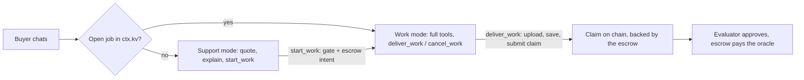

# Oracle payments (paid services)

The `OraclePaymentsPlugin` sells a professional service over chat and gets the
oracle paid on chain. It is opt-in: a host adds `new OraclePaymentsPlugin()`
to its plugins, and it stays off until `AGENT_CARD_JSON` is set.

## What a buyer sees

- **Support mode** (no open job). The oracle is a front desk. Only this
  plugin's tools and memory are bound. No other plugin, no sub-agent and no
  `load_capability`, so free support cannot do the paid work. Tools:
  `list_services`, `show_contract`, `get_contract_status`, `start_work`.
- **`start_work({ serviceId })`**. The only way a paid job begins. It runs the
  contract gate, reserves the agreed price with `MsgClaimIntent`, and records
  the job in the buyer's own store (`ctx.kv`).
- **Work mode** (a job is open). The full tool surface plus `deliver_work`
  and `cancel_work` (`billing: 'contracted'`, so they are bound only here).
- **`deliver_work`**. Uploads the deliverable to the claim bot, saves the
  claim body (the Agent Work form: `service`, `request`, `workSummary`,
  `resultStatus`, `deliverables`, `proofs`) and submits `MsgSubmitClaim` with
  `useIntent: true`. A failed submit keeps the saved claim; the retry
  resubmits it without re-uploading. A lapsed reservation is re-reserved once.
- **`cancel_work`**. Releases the escrow with a claim that delivers nothing
  (`resultStatus: unable`); the evaluator rejects it and the escrow returns.

The mode switch is the `getTurnScope` plugin hook ([plugin API](#plugin-api)).

## The contract gate

`start_work` passes only when every source the buyer cannot write agrees:

1. **Chain.** The oracle's `SubmitClaimAuthorization` grants (REST LCD):
   the collection, quota left, `max_amount` at least the price, and an intent
   window.
2. **Blocksync.** The collection's deed belongs to the sender: a
   subscription deed links them as its `user`, or they own the deed.
3. **decision-engine.** The buyer's `agent-services/v1` agreement for this
   oracle's address lists the service. Its `priceUsd` is what gets escrowed
   (`× 1 000 000` in `ORACLE_PAYMENTS_DENOM`, default `upay`). The oracle
   reads it with the counterparty self-read: a self-signed UCAN
   `{ with: 'ixo:eval-engine', can: 'agreement/read' }`. That works only when
   `ORACLE_DID` is `did:ixo:<the secp address>`.

## Setup

| What                   | Where                                                                                                                                                                                             |
| ---------------------- | ------------------------------------------------------------------------------------------------------------------------------------------------------------------------------------------------- |
| `AGENT_CARD_JSON`      | The catalog: `{ name, description?, services: [{ id, name, description?, priceUsd, doneMeans?, deliveryTime? }] }`. Same service shape as the agreement. An invalid card fails closed (no tools). |
| `ORACLE_SECP_MNEMONIC` | The oracle account's wallet (secret). With `SEQUENCE_MANAGER` it turns on `ctx.chain`.                                                                                                            |
| `SEQUENCE_MANAGER`     | Durable Object binding, `class_name: "SequenceManagerDO"`. The host re-exports `SequenceManagerDO` from `@ixo/oracle-runtime-workers`; add a migration with `new_sqlite_classes`.                 |
| Optional URLs          | `CHAIN_RPC_URL`, `CHAIN_REST_URL`, `DECISION_ENGINE_URL`, `CLAIM_BOT_URL`: all default per `NETWORK`. `ORACLE_PAYMENTS_MAX_DELIVERABLE_MB` (default 25).                                          |

On the buyer's side (portal or scripts) before a job can start: the agent
grant on their collection, a funded payment account, the deed room sourced
with the claim bot invited, and the agreement written. See
`apps/qiforge-workers-example/test/e2e-payments.ts`.

## Plugin API

Two additions, usable by any plugin:

- **`getTurnScope(ctx)`**. Narrows ONE turn before tools are collected:
  `{ commerce?, allowPlugins?, promptOverlay? }`. `commerce` becomes
  `ctx.commerce`. Several scopes intersect their allowlists. A throwing hook
  fails closed: the turn keeps only that plugin's tools.
- **`ctx.chain`**. The oracle's own account: `address()` and
  `signAndBroadcast(messages, memo)`. The wallet is memoised per isolate;
  the client and sequence stub are built per call (Cloudflare forbids reusing
  I/O objects across requests). Sequences come from one `SequenceManagerDO`
  per signer address; a sequence mismatch resets it (ahead) or waits a block
  (behind). `claimIntentExec` / `submitClaimExec` build the claim messages.

## workerd notes

- protobufjs's `BufferWriter.prototype.string` is patched before the SDK
  loads. workerd's `Buffer.utf8Write` otherwise breaks 40+ character strings
  such as ixo addresses.
- The claim bot needs an exact `size` field before the file. Without it, it
  guesses from Content-Length, which workerd's multipart encoding throws off.
- cosmjs cannot load in the vitest workerd pool. It `require()`s the ESM-only
  `@scure/bip39` wordlist, which the pool's module fallback cannot serve to
  CJS. Wrangler's esbuild bundles it fine. Signing is therefore unit-tested in
  the Node project and proven under `wrangler dev` by the devnet e2e.

## Differences from the Node plugin

- No Nest services or Redis: state is one row in the buyer's own `ctx.kv`.
- The gate reads chain + Blocksync + decision-engine. The Node plugin still
  calls the retired eval-engine (`contracts/for-oracle`).
- The claim body is saved as plain answers, not a VC. Signing a VC would need
  the oracle's Ed25519 private key in plugin code. The evaluator accepts
  either, and the claim stays authenticated (the bot save is under the
  oracle's UCAN, the chain tx under its wallet).
- Turns route by "is a job open" alone. There is no support/work classifier:
  `start_work` is the deliberate transition. The tools run on every client
  (portal, Matrix, channels), not only Matrix.
