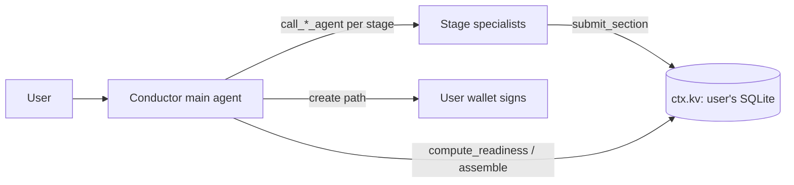
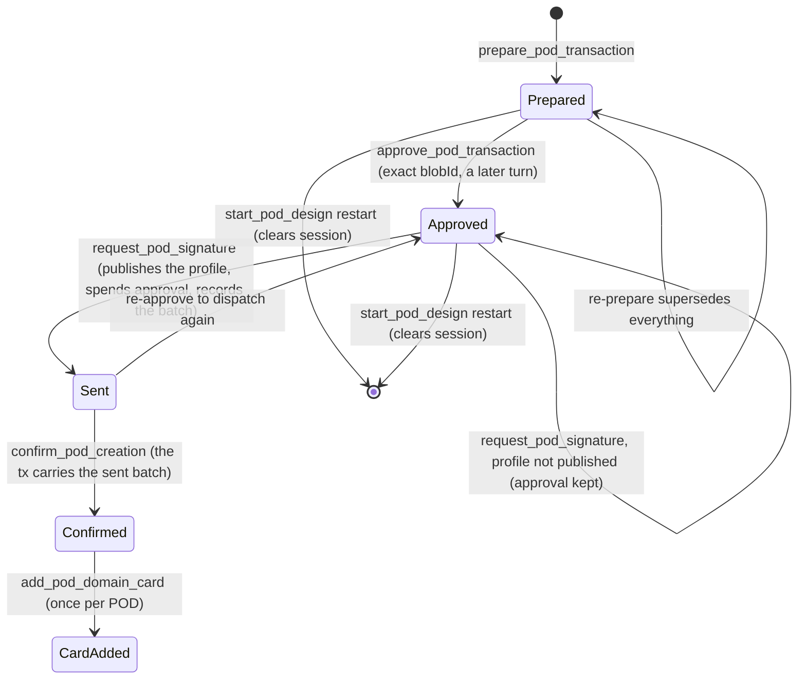

# POD Creator plugin

`src/plugins/pod-creator/` — bundled (`BUNDLED_WORKERS_PLUGINS`),
`visibility: on-demand` (hidden by the capability gate until
`load_capability('pod-creator')` or the capability router admits it),
`stability: experimental`. Design: `specs/pod-creator-plugin.md`.

Designs an IXO Programmable Organisational Domain (POD) end to end — qualify →
architect → build → evaluate → package → gate — then walks the user through an
on-chain creation the **user's wallet signs**. The oracle never holds a signing
key for creation.

## Roles and flow

The main agent is the **conductor**: it owns the blueprint lifecycle through the
orchestration tools (`start_pod_design`, `get_blueprint`, `compute_readiness`,
`assemble_blueprint`). Twelve **specialist sub-agents** (one per
`design-pod-*` capsule, defined in `design-pod-roles.ts`) do the design work.
Once a design exists, `getRequestSubAgents` binds all twelve (the runtime
wraps each as `call_<role>_agent`, `core/subagent-as-tool.ts`), and the
plugin's request middleware (`createSpecialistStageMiddleware`) re-reads the
blueprint before every model call and shows the model only the current
stage's specialists; a call to another stage's specialist is refused with the
next step instead of running. So the pipeline order is enforced, and a stage
passed during a turn hands over to the next stage's specialists on the very
next model call. (Bound per stage at turn start, as before, the next stage's
specialists were missing for the rest of that turn: a model that called them
got "no such tool" and went on telling the user they did not exist.)
Because the whole pipeline can now run in one turn, the middleware (one
instance per turn) holds two rules within a turn: a gate specialist
(evaluate or gate stage) that recorded a fail in it is not shown or run again
until the user's next message (nothing in the design changed, so a re-run
only repeats the verdict), and `start_pod_design({ restart: true })` is
refused once a specialist ran in it (a restart discards that work and is for
a user who asks for one). Without them a devnet drill re-ran the three
evaluate specialists twice after a fail, restarted the design unasked and
rebuilt it, until the 10-minute turn deadline. A specialist forwards only
its `submit_section` call into the chat (`forwardTools: ['submit_section']`):
its `read_blueprint` reads (a full-section read is often over 60 KB) stay
inside the specialist, so they never land in the conductor's thread to be
capped and paged through with `read_result`. The forwarded call is for the
chat only: the conductor's model requests leave it out (it would otherwise
take `submit_section` for one of its own tools and resend the section on
every call). A specialist that ends on an
empty reply, as models often do right after `submit_section`, hands the
conductor its last tool result instead (`{"submitted": <role>, "stage":
<stage>, "message": …}`), so the conductor can tell the section was
recorded; the message says not to call that specialist again and what comes
next. A specialist whose stage is already behind the design (its section is
recorded and the current stage is a later one) refuses to record again
(`{ submitted: false, message: "The <stage> stage is already complete; …" }`)
instead of overwriting; a failed gate verdict re-opens its own stage, so a
re-run of that role is always accepted.

The runtime calls every plugin's `getRequestSubAgents` on every turn of every
user, whether or not the capability is loaded. So until `start_pod_design` has
opened a blueprint in the thread the hook returns nothing after one local
`ctx.kv` read — no registry request, no UCAN mint, no log line — and the
qualify specialist appears on the turn after `start_pod_design`. The
registry prompts are cached per capsule, so binding all twelve costs no
request per turn. `start_pod_design`, `get_blueprint` and `compute_readiness`
return a `nextStep` in plain words: the next stage, its specialists still to
run, that they are in the tool list from the next step, and that only in the
turn that opened the design the conductor stops and asks the user to send a
message (for example "continue") — never using another stage's specialist
for them. `start_pod_design({ restart: true })` is meant
only for a user who asks to start over (its description says so; it is not
blocked).

Sections enter the blueprint **only** through a specialist's `submit_section`.
The conductor has no write path (there is no `record_blueprint_section` tool,
although the original spec listed one) — it cannot self-certify `pass`
verdicts and skip the specialists to unlock creation. Gate-bearing roles
(evaluate + gate) only satisfy readiness with an explicit `verdict: 'pass'`;
a `fail` re-opens the stage.



With no fetcher configured — the bundled default — every specialist runs on a
built-in prompt carrying its stage duties; the client answers at once, without
a request, a mint or a log line. A fork opts into the registry with
`new PodCreatorPlugin({ capsuleContentFetcher:
createRegistryInstructionsFetcher() })`, which calls
`GET {SKILLS_CAPSULES_BASE_URL}/skills/{name}/instructions` (10 s deadline,
the turn's abort signal, a 64 KB body cap — a larger body is refused) with an
`ixo:skills` invocation claiming `skills/*` and the `X-IXO-Network` header.
That endpoint serves the latest **public, mainnet** version of a skill only,
so the text is the same for every user: it is cached on the plugin instance
by capsule name (6 h). A failed fetch is remembered for 5 minutes and logged
once per capsule per window; within it the built-in prompt is used without
another request.

**Known limit — the registry names are unclaimed.** On 2026-10-05 all twelve
`design-pod-*` names answered 404 on the instructions endpoint. Whoever
publishes a public skill under one of those names controls that specialist's
system prompt — including the evaluate and gate roles whose verdicts unlock
the create path. The registry fetcher must therefore stay opt-in until the
names are owned by IXO; until then the built-in prompts are the trusted
ones.

## State and bounds

Per-thread design state is **durable**: it lives in the user's own SQLite
file through the host's `ctx.kv` surface (`UserKvSurface`, implemented by
`sqlite/user-kv-store.ts`, table `user_kv`). It survives the user object being
evicted and restored from the owner copy, and leaves with the file when the
user exports or deletes it. Every mutation is one transaction-serialised
read-modify-write, so specialists submitting sections in parallel never lose
one another's. A stored row that no longer matches the schema is reported
(blueprint) or treated as no session (create session — the safe direction for
an approval gate).

| Store                        | Where                                     | Contents                                                                                              | Bound (per user)         |
| ---------------------------- | ----------------------------------------- | ----------------------------------------------------------------------------------------------------- | ------------------------ |
| `KvBlueprintStore`           | `ctx.kv` `pod-creator/blueprints`         | one blueprint per thread                                                                              | 500 entries / 24 h idle  |
| `KvCreateSessionStore`       | `ctx.kv` `pod-creator/create-sessions`    | propose→approve state per (user, thread); what was sent for signing, the confirmed POD, its card step | 1000 entries / 1 h idle  |
| prepared batch               | `ctx.blobStore` (object storage, not SQL) | the batch's validated proto-JSON, the profile, the documents still to publish                         | 1 h TTL                  |
| public documents             | `ctx.kv` `pod-creator/public-documents`   | per homeserver + document SHA-256: the reserved (or uploaded) media                                   | 100 entries / 1 h idle   |
| `CapsuleContentClient` cache | plugin instance (isolate memory)          | SKILL.md per capsule name (public text)                                                               | 64 / 6 h; failures 5 min |

On a host without `ctx.kv` every tool fails with a clear error rather than
keeping a design silently in memory; the per-turn sub-agent hook contributes
nothing.

## The create path

A propose → approve → commit handoff (`create-tools.ts` +
`create-session-store.ts`). `prepare_pod_transaction({ name, description? })`
takes the POD's name as the user agreed it in the design (plain text, 1–100
characters, one line) and an optional description (at most 600 characters,
so the summary can quote it whole); they become the POD's public profile.
Both refuse control characters (the description keeps line breaks and tabs)
and `\p{Cf}` (bidi overrides, zero-width), `\p{Zl}`, `\p{Zp}`, `\p{Co}` and
`\p{Cn}`. The result and the batch summary the user approves show the exact
name and description. An expected refusal of the gateway (no identity, the
homeserver down, …) comes back as `{ prepared: false, retryable, message }`;
nothing is stored then.
`prepare` has the gateway compose the batch as proto-JSON messages, validates every message against the
`@ixo/ixo-transaction` catalog (the check the Portal runs again before the
wallet sees it) and that the batch is a POD batch (`podBatchProblem`: exactly
one `MsgCreateEntity`, first, and only `POD_BATCH_TYPE_URLS`), and stashes it
in `ctx.blobStore` (per-user, 1 h TTL, name `pod-batch-messages`). A gateway
batch that fails either check is an error at `prepare`, before the user is
asked anything. The message values never enter model context: the model sees
a short `blobId`, the summary, the message names and every risk.



Safety properties, in order of enforcement:

1. **Launch gate** — `prepare` refuses until `computeReadiness` is complete.
2. **Mainnet opt-in** — `prepare` and `request_pod_signature` both refuse on
   mainnet unless `POD_CREATOR_ALLOW_MAINNET=true`. The base env schema
   defaults `NETWORK` to `mainnet`, so an oracle that sets neither gets a
   refusal, never a mainnet batch.
3. **Exact-batch approval, risks accepted** — `approve` binds to the blobId
   prepared for this (user, thread); a batch prepared elsewhere cannot be
   approved here. It also needs `riskConfirmation` quoting, word for word,
   every risk `prepare` listed (each message's catalog risks, as
   `sign_ixo_transaction` requires of one message); a paraphrase or a missing
   risk is refused.
4. **Approval in a later turn** — the create session records the request
   that prepared the batch, and `approve` refuses within that request. One
   model turn therefore cannot run prepare → approve → sign by itself (for
   instance steered by injected text in the brief or a section); the user has
   to send another message after the summary was shown. This is not proof
   that a human said yes: `approve_pod_transaction` is still a tool the model
   calls, and a later turn can be steered too.
5. **Gate re-checked at signing** — `request_pod_signature` re-runs
   `computeReadiness` before spending the approval and refuses when the
   design no longer passes (restarted, expired, or a gate re-opened since the
   batch was prepared). `start_pod_design({ restart: true })` also clears the
   create session, so nothing prepared from a discarded design stays approvable.
6. **Nothing public before approval** — `prepare` only _reserves_ the
   profile's media id; `request_pod_signature` uploads the profile after the
   approval and gate checks and before spending the approval. When the upload
   fails the approval is kept and the result is `unavailable` (try again, or
   prepare again when the reservation expired).
7. **Single-use approval** — `request_pod_signature` consumes the approval
   right before dispatching, so a sign request can never be replayed; every
   dispatch needs a fresh approval (also across an object reset: the approval
   state is durable). When no Portal browser is connected nothing is sent and
   the approval is kept. Spending it records the messages sent and the
   profile in the create session.
8. **Confirmation bound to the sent batch** — `confirm_pod_creation`
   refuses when nothing was sent for signing in the thread, and the
   transaction must carry exactly one `MsgCreateEntity` whose `{id}#pro`
   proof is the one sent, owned by the user, with exactly one
   `EntityCreatedEvent` and one ownership mint whose `owner` is the user's
   address.
9. **Wallet signature** — the real human gate. The Portal re-validates every
   message against the catalog and the user reviews and signs the batch in
   their own wallet; nothing reaches the chain without it. The oracle never
   encodes or signs: it hands the wallet exactly the messages the gateway
   composed (`create-tools.test.ts` › "the oracle never signs a POD creation"
   — auth minting by the gateway is allowed, signing or broadcasting is not).

### The domain card

After a confirmed POD, `add_pod_domain_card` (no arguments) adds the POD's
public domain card the way the Portal does for a domain it creates (ixo-portal
`lib/entity/domainCard.ts`, `hooks/useCreateEntity.ts`): a W3C
VerifiableCredential of type `ixo:DomainCard` (`id: <pod>#dmn`, issuer the
owner, `credentialSubject.id` the POD, the name and description of the sent
batch; `domain-card.ts`), reserved and uploaded on the oracle's homeserver
like the profile, then one `MsgAddLinkedResource { id: <pod>, linkedResource:
{ id: "{id}#dmn", type: "domainCard", description: "Domain Card",
mediaType: "application/json", serviceEndpoint, proof, encrypted: "false",
right: "" }, signer: <address> }`, validated by the catalog, signed in the
Portal. It is an update of an entity the user owns (catalog risk `medium`):
the Portal's own consent prompt is the human gate, so there is no separate
approve step, but it runs only after a POD of this thread was confirmed and
at most once per POD (claimed while its request is out; released when
nothing was signed: declined, wallet error, failed on chain, card not
published; kept when the outcome is unknown). Once signed, the domain
indexer is asked to index the POD now (`POST {indexer}/index { did }`, no
credentials: only a forced re-index needs the indexer's admin key; devnet
`https://domain-indexer.devnet.ixo.earth`, testnet
`https://domain-indexer.testnet.ixo.earth`, mainnet
`https://domain-indexer.ixo.earth`, or `DOMAIN_INDEXER_URL`); a failure is
only logged, the indexer's chain poller indexes it later anyway.

**Known limits — what the Portal adds that the oracle does not.** The Portal
also provisions a POD's governance group (`lib/pods/provisionPodGroup.ts`: a
DAO DAO multisig through `MsgInstantiateContract`, linked as `Governs` and
added as a controller), which the `@ixo/ixo-transaction` catalog does not
support, so a POD created here has no group and its Decisions tab is empty
until one is linked. The POD's Matrix space is created by the Portal (the
rooms bot) the first time the POD is opened there.

Every step writes an audit line via `ctx.logger`
(`[pod-creator] prepared/approved/signed/confirmed …` with user DID, thread,
blobId, network, txHash).

Tool effects for durable runs (`core/middlewares/tool-marks.ts`): the pure
reads (`get_blueprint`, `compute_readiness`, `assemble_blueprint`,
`read_blueprint`) and `confirm_pod_creation` are `effect: 'read'` and may
re-run after a reset; every other tool is a write and is never repeated — in
particular a `request_pod_signature` cut off by a reset is reported as
"outcome unknown", not dispatched to the wallet a second time.

`confirm_pod_creation` returns every expected outcome as a result, never a
throw: `{ created: true, podDid, portalUrl, summary, message }` (the message
asks the model to give the Portal link and offer the domain card), or
`{ created: false, status, retryable, message }` with `status` `pending` (not
on chain within its 20 s; same hash later), `unavailable` (chain REST down,
`retryable: true`; an unreadable answer, `false`) or `failed` (failed on
chain, not this conversation's batch, not a POD; do not retry). Being a
read that returns, a `pending` call can be made again in the same turn (the
repetition guard lets an identical read run up to 5 times,
`TURN_MAX_IDENTICAL_READS`) and in later turns, and the read retry
middleware (which retries a read once only when it throws) never doubles the
20 s lookup.

### The `sign_transaction` round-trip

The POD Creator sends the **same `sign_transaction` contract as
[`IxoTransactionPlugin`](ixo-transaction.md#the-portal-handler-contract)**, in
its batch form, so one Portal handler —
`useIxoTransactionSigningAction({ chainId })` from
`@ixo/ixo-transaction/react` — serves both. The dispatch and the reading of
the answer are shared code (`src/plugins/ixo-transaction/wallet-signing.ts`),
over `ctx.frontend.callAgAction` with a 120 s deadline and the turn's abort
signal.

- **Action name:** `sign_transaction` (`SIGN_TRANSACTION_ACTION` is the
  package's `SIGN_TRANSACTION_ACTION_NAME`).
- **Args to the client:** `buildBatchSignTransactionActionArgs` over the
  stored batch —
  `{ action, network, chainId, messages, intent: { source: 'batch', summary, messages: [{ module, action, messageName, typeUrl }] }, risks, riskLevel, requiresConfirmation, riskConfirmation }`,
  no `testnetReceipt`. `chainId` is the configured network's
  (`IXO_TRANSACTION_CHAIN_ID_*`, shared with `IxoTransactionPlugin`;
  defaults `devnet-1` / `pandora-8` / `ixo-5`); `riskConfirmation` carries
  every risk, which `approve_pod_transaction` checked word for word against
  this same stored batch. The messages ride the realtime channel, not model
  context.
- **Portal side:** the handler re-validates every message against the
  catalog, refuses another chain than its wallet's, decodes each message
  with the SDK's `fromJSON` and signs all of them in **one** `transactSignX`
  call — one transaction, all or nothing on chain.
- **Result:** `SignTransactionActionResultSchema` (or a raw wallet answer
  through `normalizeWalletSignResult`), reported as:

| `status`      | When                                                                                                                                       | Approval     | Next                                                             |
| ------------- | ------------------------------------------------------------------------------------------------------------------------------------------ | ------------ | ---------------------------------------------------------------- |
| `signed`      | Signed and included with code 0; `txHash`, `code`, `height` when the wallet gave them                                                      | spent        | `confirm_pod_creation({ txHash })`; without a hash, ask the user |
| `failed`      | Included in a block with a non-zero code: nothing was created; `code`, `txHash`, `height` and the chain log                                | spent        | fix the cause, `prepare_pod_transaction` again                   |
| `rejected`    | The call failed and the Portal's error says the user declined                                                                              | spent        | the user confirms again → approve → sign                         |
| `error`       | Any other refusal (chain mismatch, a message the Portal refused, a wallet error)                                                           | spent        | as `rejected`                                                    |
| `timeout`     | No answer: deadline, the Portal tab's socket gone, or the turn aborted after sending. `outcome: 'unknown'`                                 | spent        | do not send again; ask the user whether it went through          |
| `unavailable` | No realtime channel or no Portal browser connected, or the profile could not be published (nothing sent); or no `sign_transaction` handler | kept / spent | open the chat in the Portal / wait, and call again               |

A `timeout` carries `outcome: 'unknown'` (the bridge's
`FRONTEND_OUTCOME_UNKNOWN` answer), worded exactly as `sign_ixo_transaction`
words it: the tool-execution middleware keeps the write claim, so an
identical request in a later turn is answered "outcome unknown, verify first"
instead of reaching the wallet again. `rejected` is read only from the
Portal's error text, never from a chain log. The approval is kept only when
nothing could be sent (no channel, no browser); once the request is sent it
is spent whatever the answer.

## Wiring for production

Two injectable seams on `PodCreatorPluginOptions` (the class is exported from
the package root, so a fork constructs its own instance and passes it in
`plugins: [...]` in place of the bundled singleton):

- **`chainGateway`** — composes the POD batch and resolves a broadcast tx:

  ```ts
  type GatewayResult<T> =
    | ({ ok: true } & T)
    | { ok: false; message: string; retryable: boolean };
  interface PreparedPodBatch {
    messages: ITrxMsg[];
    summary: string;
    estimatedCost?: string;
    /** Documents the messages name, uploaded after approval. */
    documents: PendingDocument[]; // { mxc, contentType, filename, text }
  }
  interface ChainGateway {
    preparePodBatch(
      input: {
        blueprint: ServicePodBlueprint;
        network: Network;
        profile: PodProfile;
      },
      ctx: RuntimeContext,
    ): Promise<GatewayResult<PreparedPodBatch>>;
    publishDocuments(
      input: { documents: readonly PendingDocument[] },
      ctx: RuntimeContext,
    ): Promise<GatewayResult<object>>;
    confirmPodCreation(
      input: { txHash: string; network: Network; sent: SentPodBatch },
      ctx: RuntimeContext,
    ): Promise<
      | { status: 'created'; podDid: string; summary: string }
      | {
          status: 'pending' | 'failed' | 'unavailable';
          message: string;
          retryable: boolean;
        }
    >;
    prepareDomainCard(
      input: { network: Network; podDid: string; profile: PodProfile },
      ctx: RuntimeContext,
    ): Promise<GatewayResult<PreparedPodBatch>>;
    requestIndexing(
      input: { network: Network; podDid: string },
      ctx: RuntimeContext,
    ): Promise<void>;
  }
  ```

  Expected refusals are results; a throw is a programming error.

  `messages` are proto-JSON `{ typeUrl, value }` (camelCase fields, integer
  amounts as strings, bytes as base64, timestamps as RFC 3339 strings) with
  exactly the fields of their `@ixo/ixo-transaction` catalog entry, at most
  `MAX_BATCH_MESSAGES` (16), `MsgCreateEntity` first and only
  `POD_BATCH_TYPE_URLS`. `summary` is at most 1000 characters. Never encoded
  bytes: the Portal signs only messages it can show and re-validate.

  **The bundled gateway** (`createIxoChainGateway()`,
  `ixo-chain-gateway.ts`) is the default when no `chainGateway` is passed.
  It creates the POD as **one** `MsgCreateEntity`, the message the Portal
  builds when a user creates an entity there (ixo-portal
  `lib/entity/createEntity.ts`). One message because the chain derives the
  entity DID while the transaction runs (`did:ixo:entity:` + the MD5 of
  `<nft contract>/<entity create sequence>`, ixo-blockchain
  `x/entity/keeper/msg_server.go`): a later message in the same transaction
  could name it only by predicting that sequence, and the whole transaction
  fails when another creation lands first. A claim collection, entity
  accounts and grants come afterwards, once the DID is known
  (`MsgCreateClaimAuthorization` cannot be signed by the user at all: its
  signer is the entity's admin module account).

  `preparePodBatch` (one 20 s budget for every step):

  1. **Owner** — `ctx.user.did` must be an IXO account DID
     (`did:ixo:ixo1…`); the address is read off it. Anything else is refused
     before any request.
  2. **Identity document** — `GET {chain REST}/ixo/did/dids/{did}` must
     exist and list the account the way the chain's ante handler checks the
     signer of a `MsgCreateEntity` (ixo-blockchain `x/iid/ante/iidtx.go`,
     `IidDocument.HasRelationship`): a verification method named under
     `authentication` or `assertionMethod` whose `blockchainAccountID` is the
     address, or whose key material (`publicKeyMultibase` as hex after its
     one-character prefix, `publicKeyHex`, `publicKeyBase58`) is a 33-byte key
     whose RIPEMD-160 of SHA-256 is the account. Missing ("Your identity … is
     not on chain yet") or not listing it ("Your identity document does not
     list your account …") is refused: the chain would refuse the
     transaction.
  3. **Owner key** — a secp256k1 key of the account in that document
     (`EcdsaSecp256k1VerificationKey2019`, compressed), else the account's
     own `pub_key` (`GET {chain REST}/cosmos/auth/v1beta1/accounts/{address}`,
     a `BaseAccount` or the base account inside a vesting account) when it is
     the account's. With none: "There is no public key on chain yet for your
     account …".
  4. **Profile** — `{ "@context", id: "ixo:entity#profile", type: "profile",
orgName, name, image: "", logo: "", brand, location: "", description }`
     (the Portal's shape), serialised once and **reserved** on the oracle's
     homeserver with the plugin device (`matrix-media.ts`): Matrix's
     asynchronous upload (client-server API v1.7) `POST
     {homeserver}/_matrix/media/v1/create` answers a `content_uri` (and
     `unused_expires_at`) with no content yet; `request_pod_signature` later
     uploads the exact bytes with `PUT
     {homeserver}/_matrix/media/v3/upload/{server}/{media id}`, where a 409
     (`M_CANNOT_OVERWRITE_MEDIA`, the same bytes uploaded before) is a
     success and a 404 (the reservation expired) asks for a new prepare. A
     homeserver without `create` (404/405 or `M_UNRECOGNIZED`) gets the
     profile uploaded at once (`POST /_matrix/media/v3/upload`), public
     before approval. The same bytes reserved or uploaded for the user are
     reused (`ctx.kv` `pod-creator/public-documents`, keyed by homeserver and
     SHA-256; a reservation with less than an hour left is not). Every
     homeserver request: 10 s bound and the prepare's deadline, the turn's
     abort, a 16 KiB answer cap, no redirects; `botCredentials()` bounded the
     same way (10 s); a 401 asks the host once for fresh credentials
     (`botCredentials({ rejected: <token> })`) and retries. The linked
     resource is the Portal's `{ id: "{id}#pro", type: "Settings",
description: "Profile", mediaType: "application/json", serviceEndpoint,
proof, encrypted: "false", right: "" }`, with `serviceEndpoint` the
     public download URL the Portal's `mxcUrlToHttp` forms
     (`{homeserver}/_matrix/media/v3/download/<server>/<media id>`) and
     `proof` the hex SHA-256 of the exact bytes.
  5. **Message** — `entityType: "pod"`, `entityStatus: 0`, `controller:
[did]`, empty `context`, `service`, `accordedRight`, `linkedEntity`,
     `linkedClaim`, the four verification methods
     `customMessages.iid.createIidVerificationMethods` makes for the key
     (`did` and `did#<base58>` with `publicKeyBase58`, `did#<hex>` with
     `publicKeyMultibase: "F<hex>"`, `did#<address>` as
     `CosmosAccountAddress`), the profile resource, `startDate` now and
     `endDate` 100 × 365 days later, `ownerDid`, `ownerAddress` and the
     relayer node the network's Portal names on the domains it creates (its
     `NEXT_PUBLIC_DAO_DID`, ixo-portal `lib/entity/createEntity.ts`; the
     mainnet Portal lists only entities of this relayer that are verified,
     `lib/gql/addFilters.ts`): mainnet
     `did:ixo:entity:47d9c64891e77cb8e588d33b83ab3042` (Qi.Space), testnet
     `did:ixo:entity:3d079ebc0b332aad3305bb4a51c72edb`, devnet
     `did:ixo:entity:ac12c6f8f299071eb24f2a10591d7ab7` (Shelves Relayer), or
     `POD_CREATOR_RELAYER_NODE_DID`. Not the oracles' relayer
     (`lib/oracle/networkConfig.ts`). Summary: `Create the POD on <network>,
owned by you (<address>). Its public profile: name "<name>"; description
"<description>".`

  `confirmPodCreation`: the Portal wallet answers with the hash, code and
  height (no events), so the gateway reads `GET {chain REST}/cosmos/tx/v1beta1/txs/{hash}`,
  asking again every 2 s while the node answers 404 (not indexed yet) or a
  retryable failure (429, 5xx, a network error or timeout), for at most 20 s
  in all; past that it answers `pending` or `unavailable` with the time it
  really looked. A non-retryable failure (an unreadable or oversized answer)
  is `unavailable` with `retryable: false` at once. A non-zero `code` is
  `failed` ("no POD was created", with the chain log). Otherwise the
  transaction must carry the batch the conversation sent (exactly one
  `MsgCreateEntity`, its `{id}#pro` proof the sent one, `owner_did` the
  user), exactly one `ixo.entity.v1beta1.EntityCreatedEvent` (`entity` JSON
  `.id`, `signer` the owner DID) and exactly one ownership NFT mint (`wasm`
  `action: mint`, `token_id`) whose `owner` is the user's address (the
  binding owner), and the `MsgCreateEntityResponse.entity_id` in the result
  data (hex `TxMsgData`), when present, must agree; every type named must be
  `pod`. Anything else is `failed`.

  Every chain read goes through the ixo-chain plugin's `restJson` (8 s per
  attempt, 512 KiB body cap, one retry on 429/5xx/network errors, the
  user's chain read permits; an upstream that failed so is held back for
  10 s, which the confirm poll waits out). The chain REST base URL is the network's
  default (`CHAIN_REST_URLS`: devnet reads devnet) unless `CHAIN_REST_URL` is
  set; the network passed in, not `NETWORK` re-read, picks it.

  **Known limit — authenticated media.** The profile URL is the legacy
  unauthenticated download path, as the Portal's. A homeserver that serves
  new media only on the authenticated endpoint (Synapse
  `enable_authenticated_media`) answers that URL with 404 for a profile
  uploaded after the switch; readers then need the `mxc` through the
  authenticated endpoint. Entities the Portal creates have the same limit.

  A fork can pass its own gateway, or `notConfiguredChainGateway` (throws
  "ChainGateway not configured" from every method) to keep on-chain creation
  off: the tools then report it unavailable without calling the gateway.

- **`capsuleContentFetcher`** — see above.

Config: `POD_CREATOR_ALLOW_MAINNET` (plugin-owned, default `false`; the
string `'true'` from a Worker var is accepted),
`POD_CREATOR_RELAYER_NODE_DID` (the relayer node a POD names; default the
network's Portal relayer above), `POD_CREATOR_PORTAL_URL` (the Portal a
confirmed POD is linked in, `<portal>/domain/<did>/overview`; default devnet
`https://dev.portal.qi.space`, testnet `https://test.portal.qi.space`,
mainnet `https://portal.qi.space`) and the chain ids
`IXO_TRANSACTION_CHAIN_ID_DEVNET` / `_TESTNET` / `_MAINNET` (the
ixo-transaction plugin's own schema objects, declared by both plugins, so
one set of variables configures both and the boot reports no collision);
`NETWORK`, `SKILLS_CAPSULES_BASE_URL`, `CHAIN_REST_URL` and
`DOMAIN_INDEXER_URL` are read as siblings (owned by the base schema, the
skills, ixo-chain and domain-indexer plugins). The create path uses `NETWORK`; the capsule
client falls back to `testnet` only when the config is unreadable.
`request_pod_signature` refuses when either `NETWORK` or the stored batch's
network is mainnet without the opt-in, before spending the approval.

## Differences from the Node implementation (pull request 210)

| Node                                                                                                                     | Workers                                                                                                                            | Why                                                                                                                                          |
| ------------------------------------------------------------------------------------------------------------------------ | ---------------------------------------------------------------------------------------------------------------------------------- | -------------------------------------------------------------------------------------------------------------------------------------------- |
| `InMemoryBlueprintStore`, `InMemoryCreateSessionStore` on the plugin instance                                            | `KvBlueprintStore`, `KvCreateSessionStore` over `ctx.kv`                                                                           | The user object is evicted and restored from its owner copy; process memory would lose the design. Same LRU / idle-TTL limits, now per user. |
| Stores passed to the tool factories                                                                                      | Store **resolvers** `(ctx) => store`                                                                                               | The store is per user (per Durable Object), so it is resolved from each call's context, never from the context that built the tools.         |
| In-place read-modify-write                                                                                               | Atomic `ctx.kv.update` (SQLite transaction)                                                                                        | SQLite access is async; without it, parallel `submit_section` calls lose sections (proven by `user-kv-store.test.ts`).                       |
| `callAgAction` from `@ixo/common` (WS gateway)                                                                           | `ctx.frontend.callAgAction` (realtime channel), `hasClient` check                                                                  | The Workers runtime's AG-UI bridge.                                                                                                          |
| `node:crypto` `randomUUID`                                                                                               | global `crypto.randomUUID`                                                                                                         | workerd.                                                                                                                                     |
| `ixo:skills` mint without an ability                                                                                     | mint claiming `skills/*`                                                                                                           | On Workers an unqualified mint claims `'*'`, which only a `'*'` grant covers (same as the Workers skills plugin).                            |
| Capsule cache keyed by thread, failures never cached                                                                     | keyed by capsule name; failures remembered 5 min, logged once                                                                      | The endpoint serves public content only; a per-turn retry of an unpublished capsule would cost a request and a log line on every turn.       |
| Default fetcher that throws (UCAN mint + warn on every build)                                                            | no fetcher → built-in prompt at once, no mint, no log                                                                              | The sub-agent hook runs on every turn of every user.                                                                                         |
| Qualify specialist offered before any design exists                                                                      | no specialists until `start_pod_design`                                                                                            | Same reason: no per-turn work for users who never asked for a POD.                                                                           |
| Approval accepted in the turn that prepared the batch                                                                    | refused in that turn                                                                                                               | One model turn must not reach the wallet prompt on its own.                                                                                  |
| Signature requested on any approved batch                                                                                | launch gate re-checked; restart clears the session                                                                                 | A batch from a discarded or re-opened design must not reach the wallet.                                                                      |
| Default fetcher only                                                                                                     | + opt-in `createRegistryInstructionsFetcher()` (64 KB cap)                                                                         | The registry content endpoint was confirmed (`/skills/{name}/instructions`); the bundled default is unchanged.                               |
| Undeclared tool effects                                                                                                  | `effect: 'read'` on the four pure reads                                                                                            | Durable runs re-run reads after a reset and never repeat writes.                                                                             |
| Gateway returns base64 unsigned tx bytes; `sign_transaction` args `{ blobId, unsignedTx, network }`, result `{ txHash }` | Gateway returns proto-JSON messages; the ixo-transaction `sign_transaction` batch form and result contract                         | The Portal signs only messages it can show and validate; one handler serves both wallet-signing plugins.                                     |
| Approval without risks                                                                                                   | Approval quotes every risk of every message                                                                                        | Same risk gate as `sign_ixo_transaction`.                                                                                                    |
| Every failure "did not complete", approval spent                                                                         | `signed` / `failed` / `rejected` / `error` / `timeout` (unknown, claim kept) / `unavailable` (approval kept when nothing was sent) | A lost answer must not read as a failure: the wallet may still sign.                                                                         |
| Bundled in `BUNDLED_PLUGINS`                                                                                             | Bundled in `BUNDLED_WORKERS_PLUGINS`                                                                                               | Same; on-demand, so inert until loaded.                                                                                                      |

## Tests

- `pnpm test` (workerd) — `src/plugins/pod-creator/*.test.ts` (bounded map,
  blueprint store, create-session store, capsule client + registry fetcher,
  stage, orchestration tools, sub-agents, create tools, plugin boot through
  `createRuntimeCore`). `request-pod-signature.test.ts` drives the create
  path through the plugin's own tools against a fake AG-UI bridge over the
  real `FrontendCallRegistry`: the dispatched args are exactly
  `buildBatchSignTransactionActionArgs` of the stored batch and pass the
  package's own Portal-side check (`signIxoTransactionWithWallet`, one
  wallet call for the whole batch); every outcome; a lost socket and an
  abort after dispatch as an unknown outcome that keeps the write claim
  (`uncertainResultReason`); the approval kept when no browser is
  connected; the chain id per network and its shared overrides; the mainnet
  gate at prepare and at signing; the bundled gateway as the default and the
  not-configured one a fork can pass; and booting
  beside `IxoTransactionPlugin` without a key collision.
  `create-tools.test.ts` covers the gateway batch being refused at prepare
  (outside the catalog, or not a POD batch), a gateway refusal reported as
  a result, the required name, the refused characters and the 600-character
  description, the profile handed to the gateway, the word-for-word risk
  acceptance at approve, the profile published after the approval check and
  before the wallet (nothing published without approval, the approval kept
  when publishing fails), what the model sees for every confirm outcome
  (`effect: 'read'`, the Portal link, nothing sent → refused), and the card
  step (once per POD, released or kept by outcome, a wrong batch refused,
  the mainnet gate). `ixo-chain-gateway.test.ts` drives the bundled gateway
  against a fake chain REST, homeserver and indexer, on a faked clock (the
  waits are injected, nothing waits for real): the profile document and its
  reservation, the `MsgCreateEntity` passing `validateTransactionBatch` and
  `podBatchProblem` and surviving the SDK's `fromJSON`, the REST base and
  relayer per network and its override, the IID document missing or not
  listing the account (and `assertionMethod` accepted), the key from the IID
  document or the account, the one prepare budget, confirm polling through
  404, 429, 5xx and network errors, `pending`/`unavailable` with the real
  elapsed time, an unreadable or oversized answer, the turn's abort while
  waiting, every binding refusal, and the card and indexer calls.
  `matrix-media.test.ts` covers the reservation and upload against Synapse's
  answer shapes: reuse of the same bytes, the fallback without async
  uploads, a 401 and fresh credentials, `botCredentials` failing or hanging,
  a request that hangs, the spent budget, the turn's abort, 409 as success
  and an expired reservation. `sub-agents.test.ts` and
  `orchestration-tools.test.ts` cover a passed stage's specialist refusing
  to record again, a failed gate re-recorded, `nextStep`, and the stage
  middleware (only the current stage's specialists shown, the next stage's on
  the next model call, another stage's call refused). Also `src/sqlite/user-kv-store.test.ts`: `ctx.kv`
  over real DO SQLite (TTL, LRU, atomic updates, eviction) and the plugin
  driven through its own tools and sub-agents across an eviction and across
  an owner-copy wipe + re-import.
- `pnpm test:core` — `src/core/user-kv.test.ts`.
- `pnpm --filter @ixo/ixo-transaction test` — the batch form itself
  (`tests/batch.test.ts`) with a POD-shaped batch, and the Portal handler
  decoding and signing it in one call (`tests/react-handler.test.ts`).
- `pnpm test:e2e:pod` (example app, real model, local harness) — capability
  load, `start_pod_design`, the qualify specialist as a sub-agent, the
  blueprint after `/debug/object/abort` and after `/debug/storage/reset`, and
  the launch gate refusing `prepare_pod_transaction`.
