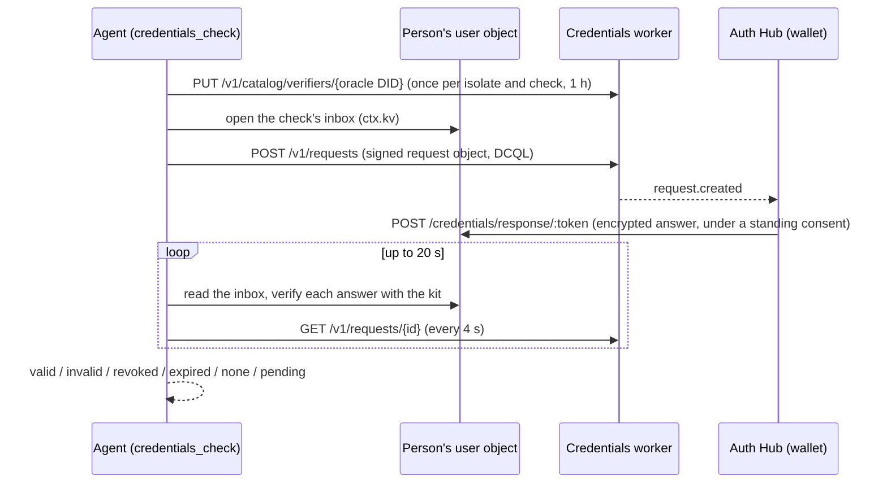

# Credentials (credentials plugin)

The `credentials` plugin (`src/plugins/credentials/`) lets an oracle check a
person's verifiable credentials and ask their permission, in the IXO wallet,
before it does so. It is generic: any credential type, any issuers, any
fields, plus the actions in the Auth Hub's curated catalogue (today one,
`self.identity-check`). It works in our WhatsApp chat only for now.

It is in `BUNDLED_WORKERS_PLUGINS` and stays off unless
`CREDENTIALS_ENABLED=true` and the oracle account's Hub key are set
([Turning it on](#turning-it-on)). Nothing is deployed with it yet.

## The two cards

The person only ever sees two fixed cards, drawn by the Auth Hub on its own
page from fixed fields (never from text the oracle writes):

- **Check a credential.** Who asks (the oracle entity's name and logo from IXO
  Names), the credential, who issued it, the fields the oracle will see and how
  long. Allow gives the oracle a standing consent in the person's wallet: from
  then on the wallet answers the oracle's presentation requests for that
  credential by itself.
- **Use a service for you.** Who asks, the action, the service, what it allows
  and how long. Allow signs the catalogue entry's delegations, person to
  oracle; the oracle reads them back to call the service.

Both have the same two buttons: Don't allow and Allow. Who asks is the DID
that signed the request (the oracle's own DID); the permission is made out to
it.

## Tools

| Tool                                    | What it does                                                                                                                                              |
| --------------------------------------- | --------------------------------------------------------------------------------------------------------------------------------------------------------- |
| `credentials_request_check_permission`  | Asks the Hub for a "check a credential" card (`vct`, 1–5 `issuers`, 1–30 `claims`, `days` 1–90) and returns `{ permissionId, url, expiresAt }`.           |
| `credentials_permission_status`         | The card's status (`pending`, `allowed`, `declined`, `expired`, `stopped`). Never the grants.                                                             |
| `credentials_check`                     | Checks a credential at the Credentials worker and returns `valid` (with only the fields asked for), `invalid`, `revoked`, `expired`, `none` or `pending`. |
| `credentials_request_action_permission` | Asks the Hub for a "use a service for you" card for a catalogued action (`days` 1–30, or the entry's usual length).                                       |
| `credentials_request_action`            | Carries out an allowed action: for `self.identity-check`, a link from Self where the person starts an identity check.                                     |
| `credentials_action_status`             | The progress of that action (`sent`, `opened`, `in_progress`, `passed`, `failed`, `expired`, `cancelled`). No personal data.                              |

Every answer is plain data plus a `message` the agent can send as it is. A
link always goes to the person as one link in a short message; the agent
never sees a token. A refusal is the house shape `{ error, message }`: `error`
is the code (for developers and logs), `message` a plain sentence without
codes, DIDs or addresses.

The plugin is on-demand (`load_capability(['credentials'])`). Its operating
guide tells the agent the rules above.

## How a check works

- The oracle is the verifier: the request object's `client_id` is the
  oracle's own DID, signed with its own key (the one on its DID document that
  signs its UCANs, `ctx.ucan.signWithOracleKey`). DCQL asks for one credential
  of `vct`, `iss` among `issuers`, the `claims` asked, holder binding
  required, the answer encrypted to a P-256 key of this check.
- The catalog entry (`name` and `description` from the oracle's config,
  `accepts` merged with what the check asks for) is read and written only when
  it does not cover the check yet.
- The answer comes to the oracle's response endpoint, `POST
/credentials/response/:token` (this plugin's one route, outside UCAN auth).
  The token is sealed with AES-GCM under a key derived (HKDF) from the Hub key
  and the oracle DID, and names the person, the check and its end. A token
  not made here, or ended, is refused before any user object is woken; a good
  one appends the body to the check's inbox in the person's own object
  (`deliverPluginInbox`, `src/core/plugin-inbox.ts`). The person's DID never
  appears in the request object.
- The waiting tool decrypts and verifies each answer with
  `@ixo/credentials-kit` (`verifyAuthorizationResponse`, `expectedSubject` =
  the person). An answer that does not prove to come from the person is
  ignored (anyone holding the public request object can post one). A status
  list or DID host that is down is "try again later", never a pass.
- No standing consent answers in 20 s: `pending` with the Hub wallet link
  (`/credentials/requests/<id>`). The request and its keys stay in the
  person's `ctx.kv` for its 15 minutes, so calling again with the same fields
  continues it (no second request). A decline, cancel or expiry at the worker
  is `none`. An answer the worker saw that never reached the endpoint closes
  the request (`answer_lost`) so the next call starts afresh.

## Calls to the Hub and Self

- **Hub** (`/api/internal/permissions`): `x-channels-service-key` (the oracle
  account's key) plus a UCAN invocation issued by the oracle's DID to the
  Hub's did:web, `permissions/request` on `ixo:permissions`, 2 minutes,
  single use. Its first fact binds the request: `{ method, path }` and, for
  the POST, `body_sha256`, the hex SHA-256 of the JSON body without its
  `invocation` field, keys sorted. The POST carries the invocation in the
  body's `invocation` field, the GET in `Authorization: Bearer`. The request
  key is derived from the run and the tool call, so a resumed run asks for
  the same card.
- **Self** (`/identity/v1/links`): an invocation from the person's `link`
  grant (person to oracle, the one proof; grants are picked by their `id`,
  `link` and `offer`), `identity/link` on `ixo:identity`, to Self's
  did:web, 4 minutes, with the facts `{ method, path }` and `{ entityDid }`
  (the oracle's entity, which Self checks against its `#orz` and names from
  IXO Names). The body carries the `offer` delegation as `offerConsent`. A
  link already open (`409 link_active`) is reused: the answer is
  `already_open` with its `linkId`.
- **Credentials worker**: self-signed invocations, `credentials/verify` on
  `ixo:credentials`, bound to `{ method, path }`.

Every call has a 10 s timeout and one retry on a 5xx or 429 (after its
`Retry-After`, when that is at most 5 s), each attempt with a fresh
invocation. A timeout is not retried.

## WhatsApp only

Every tool first calls `whatsAppBinding(ctx)`: the turn must come from IXO
Channels (`ctx.session.client === 'channel'`) with
`ctx.session.channel.provider === 'whatsapp'`. Both are set by the runtime
from the authenticated channel turn, never by the model. Anywhere else the
tool answers `whatsapp_only` and calls nothing. The Hub only issues cards to
channel bindings anyway: the card request carries the turn's `bindingId` and
`bindingRevision`.

## Turning it on

| Variable                       | Meaning                                                                                                                                                    |
| ------------------------------ | ---------------------------------------------------------------------------------------------------------------------------------------------------------- |
| `CREDENTIALS_ENABLED`          | `'true'` turns the plugin on. Default `'false'`.                                                                                                           |
| `AUTH_HUB_CHANNEL_SERVICE_KEY` | Secret. The oracle account's key on the Hub (the one IXO Channels and Hub actions use). Required.                                                          |
| `AUTH_HUB_URL`                 | The Hub. Default per `NETWORK`: `https://dev.auth.ixo.earth`, `https://test.auth.ixo.earth`, `https://auth.ixo.earth`.                                     |
| `CREDENTIALS_URL`              | The Credentials worker. Default per `NETWORK`: `https://dev.credentials.ixo.earth`, `https://test.credentials.ixo.earth`, `https://credentials.ixo.earth`. |
| `SELF_API_URL`                 | Self's API. Default per `NETWORK`: `https://api.dev.self.ixo.earth`, `https://api.test.self.ixo.earth`, `https://api.self.ixo.earth`.                      |
| `SELF_WEB_URL`                 | Self's web app, the only origin an identity-check link may be on. Default: `SELF_API_URL`'s host without its leading `api.`.                               |

Also read: `ORACLE_DID` (the issuer of every call, the verifier),
`ORACLE_ENTITY_DID` (sent to Self; the Hub names the card from the account's
entity), `ORACLE_PUBLIC_URL` (the response endpoint; `credentials_check` is
unavailable without it), `BLOCKSYNC_GRAPHQL_URL` (DID resolution),
`ORACLE_SIGNING_MNEMONIC` (through `ctx.ucan`; without it every tool is
unavailable). Each service's did:web is derived from its host.

The oracle account needs `ACTION_CARDS_ENABLED` on the Hub, a name in IXO
Names for its entity, and the oracle's Ed25519 key on its DID document (as for
every oracle that signs UCANs).

## Security notes

- Tokens and delegations never reach the model: grants are read from the Hub
  per call and passed straight to Self. Card and link URLs are checked to be
  on the Hub's and Self's own origins before the agent may share them.
- A check's request object and response private key live in the person's own
  `ctx.kv` (their database, exported only as their encrypted owner copy) for
  the request's 15 minutes and are deleted when the check ends.
- Only the claims asked for come back; logs carry the service, status and
  code of a failure, never claims, DIDs, tokens or bodies.
- Known limits: the response endpoint answers 200 once an answer is stored,
  before the tool verifies it, so the Hub counts an answer as received even
  if verification later fails. Rotating the Hub key ends every check in
  flight (their tokens no longer open). The verifier catalog entry is read,
  merged and written per isolate: two isolates adding different checks at the
  same moment can drop one until its memo expires (the wallet then only notes
  that the request asks for more than is published).

## Tests

`src/plugins/credentials/*.test.ts` run in the workerd pool (WebCrypto ECDH,
HKDF and AES-GCM on the real runtime): the clients against a routing fetch
(success, 401, 409 `link_active`, 429 with and without a short
`Retry-After`, 5xx, timeouts, foreign link origins), the body hash and the
invocation facts, the response token and route, the WhatsApp gate for every
tool, and every tool's output. `credentials_check` runs a real OpenID4VP round
trip: the kit's wallet side answers the oracle's signed request, the answer
goes through the sealed response token into the inbox, and the tool verifies
it (valid, revoked, junk ignored, declined, pending then continued, an answer
lost). `src/core/plugin-inbox.test.ts` and the new cases in
`src/do/ucan-service.test.ts` cover the inbox and the request-bound facts and
oracle-key signing.
