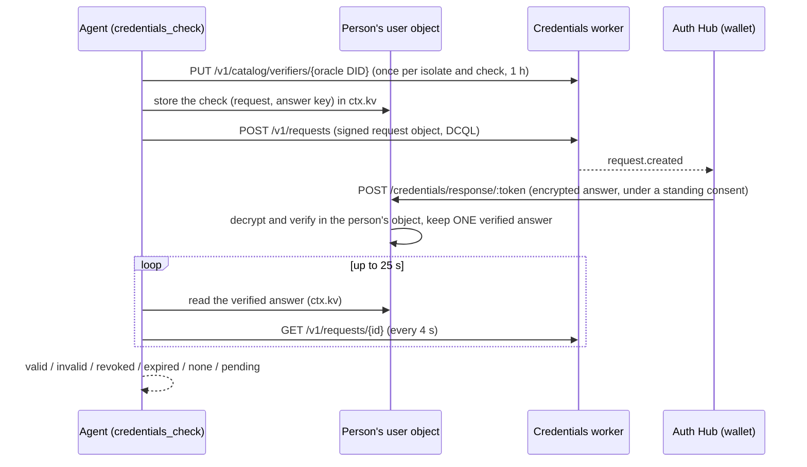

# Credentials (credentials plugin)

The `credentials` plugin (`src/plugins/credentials/`) lets an oracle check a
person's verifiable credentials and ask their permission, in the IXO wallet,
before it does so. It is generic: any credential type, any issuers, any
fields, plus the actions in the Auth Hub's approved list (today
`self.identity-check`). It works in our WhatsApp chat only for now.

It is in `BUNDLED_WORKERS_PLUGINS` and stays off unless
`CREDENTIALS_ENABLED=true` and the oracle account's Hub key are set
([Turning it on](#turning-it-on)). Nothing is deployed with it yet.

## One card for everything

The person taps ONCE for everything an oracle needs. The Auth Hub draws one
card on its own page from fixed fields (never from text the oracle writes),
holding 1-5 items:

- **Check a credential** item: the credential, who issued it, the fields the
  oracle will see and how long. Allow gives the oracle a standing consent in
  the person's wallet: from then on the wallet answers the oracle's
  presentation requests for that credential by itself.
- **Use a service for you** item (`service-action`): an entry id from the
  Hub's approved list (the Hub validates it and refuses ids it does not know;
  use only an entry id the operator's instructions name; `self.identity-check`
  is the only built-in one). Allow signs the entry's delegations,
  person to oracle, and writes the entry's own standing consents. Today's
  entry, `self.identity-check`, yields on ONE card the `link` and `offer`
  grants AND a standing consent for Self's verifier, so a later
  `credentials_check` of IdentityLevel1 needs no second card.

One Allow covers every item (no partial answer); Don't allow covers none. Who
asks is the DID that signed the request (the oracle's own DID); the
permission is made out to it.

Ask for everything in one request:

- Identity: one request with
  `[{ kind: "service-action", action: "self.identity-check", days }]` covers
  the link, the offer and the consent. Add a `credential-check` item only for
  other credential types.
- Anything else: list every credential check and service action the task
  needs in the one `items` list.

## Tools

| Tool                                    | What it does                                                                                                                                                                                                                                                                                                                                                                                                                                                                   |
| --------------------------------------- | ------------------------------------------------------------------------------------------------------------------------------------------------------------------------------------------------------------------------------------------------------------------------------------------------------------------------------------------------------------------------------------------------------------------------------------------------------------------------------ |
| `credentials_request_permissions`       | Asks the Hub for ONE card holding `items` (1-5): `{kind:"credential-check", vct, claims, issuers?, days}` or `{kind:"service-action", action, days?}`. Returns `{ status: "sent", permissionId, url, expiresAt }`, or `{ status: "already_allowed", permissionId }` when the Hub already holds what was asked ([The Hub is the source of truth](#the-hub-is-the-source-of-truth)).                                                                                             |
| `credentials_request_check_permission`  | A one-item wrapper of the above for a credential check (`vct`, 1-5 `issuers`, 1-30 `claims`, `days` 1-90).                                                                                                                                                                                                                                                                                                                                                                     |
| `credentials_request_action_permission` | A one-item wrapper for a service action (any entry id of the Hub's pattern, `days` or the entry's usual length).                                                                                                                                                                                                                                                                                                                                                               |
| `credentials_permission_status`         | The card's status (`pending`, `allowed`, `declined`, `expired`, `stopped`) and `items[]`: each item's `index`, `kind`, `state` and, once allowed, what was granted (consent ids; grant ids, capabilities, audiences and ends; never for an item the Hub marks `current: false`, which carries `current: false` instead and makes the answer "I need your OK once more for this."). Never a token.                                                                              |
| `credentials_check`                     | Checks a credential at the Credentials worker and returns `valid` (with only the fields asked for), `invalid`, `revoked`, `expired`, `none` or `pending`.                                                                                                                                                                                                                                                                                                                      |
| `credentials_request_action`            | Carries out an allowed action. For `self.identity-check`: a link from Self where the person starts an identity check, using the `link`/`offer` grants of that item in the one card. For any other entry: `granted`, listing the capabilities allowed (no tokens) so the agent or another plugin can act. When what the person allowed is out of date (`current: false`) it sends ONE card again itself: `{ status: "sent", permissionId, url }` asking for their OK once more. |
| `credentials_action_status`             | The progress of an identity-check link (`sent`, `opened`, `in_progress`, `passed`, `failed`, `expired`, `cancelled`). No personal data.                                                                                                                                                                                                                                                                                                                                        |

Every answer is plain data plus two texts: `message`, in the second person,
for the person and ready to send as it is, and `hint`, guidance for the agent
(what to do next; never sent). A link always goes to the person as one link
in a short message; the agent never sees a token. A refusal is the house
shape `{ error, message, hint? }`: `error` is the code (for developers and
logs), `message` a plain sentence without codes, DIDs or addresses.

Rules the tools keep:

- Why the oracle asks (`purpose`, shown in the person's wallet and the
  catalog) is never the model's text and is not a tool input: it is the
  operator's `CREDENTIALS_PURPOSES` entry for the type, else "Check your
  <type name>", with links, markup and control characters stripped.
- `credentials_permission_status` answers only this person's cards: the ids
  their kv recorded (the cards the request tools sent; each id is recorded
  once, with its item kinds and its link) and, for an id the kv does not
  hold, the ones the Hub lists for this person's binding. Any other id is
  `not_found`; the card itself is never read.
- A request that the Hub refuses with `400 invalid_item` (`details.index`,
  `details.reason`) is answered "Item N of this request isn't something we
  can set up." (N counts from 1; the reason stays with the agent). An unknown
  entry id comes back the same way (or as `unknown_action`). The same
  `requestKey` with another list is `request_conflict`, handled as before.
- The grants of an allowed service-action item are kept in the person's kv until the
  earliest of them ends, so repeat calls do not ask the Hub again. When Self
  answers 401 or 403 to kept grants (stopped or ended), they are dropped,
  fetched again and the call is retried once. When that card has ended too,
  the Hub's list is read once for a newer one before the answer is "ask for
  permission".
- A link's status is kept 5 s before Self is asked again (a final status for
  good), and `credentials_action_status` answers at most 6 calls a minute per
  link (Self's own limits: 2000 links a minute per oracle, 6000 status reads
  a minute per oracle and 30 a minute per oracle and link). A new
  `credentials_request_action` replaces a link nobody has opened yet (the old
  URL stops working); Self answers 409 `link_active` only while a check is in
  progress, and that link is continued, not recreated.
- An end the person reads (the link's, an open check's) is their local time
  when the runtime knows their zone (`ctx.user.timezone`: "It works once and
  ends at 18:05"), else relative to now, since WhatsApp gives no zone: "It
  works once and ends in 15 minutes" (minutes rounded up, never "in 0
  minutes"; "in about 2 hours", "in about 3 days" beyond). Never "UTC". An end
  that has already passed is left out ("Your identity check is already in
  progress. Please carry on with it.": a check started in time runs on after
  its link's end).
- One deadline per tool (25 s): every call a tool makes, its retry and, for
  `credentials_check`, the wait for the answer end inside it. An error while
  asking the worker for the request's status inside the wait means keep
  waiting.
- Rows of checks that have ended are removed on the next `credentials_check`
  (their kv rows also expire on their own idle lifetime).

The plugin is on-demand (`load_capability(['credentials'])`). Its operating
guide tells the agent the rules above.

## The Hub is the source of truth

What a person allowed lives in the Auth Hub. The person's kv (`permissions`,
`action:<id>`, `grants:<id>`, `pending:<id>`, `permstatus:<id>`) is only a
cache of it: an oracle that lost it (a person's database emptied or
restored, an expired row) reads it back instead of asking the person again.

`GET /api/internal/permissions?bindingId=<id>&bindingRevision=<n>` lists the
person's live cards at this oracle: at most 32, newest first, each in the
shape of the status answer (waiting cards that have not ended, allowed cards
with something still running). The plugin reads it at most once per tool
call:

| When                                                                                                                  | What happens                                                                                                                                                                                                                                                                                                  |
| --------------------------------------------------------------------------------------------------------------------- | ------------------------------------------------------------------------------------------------------------------------------------------------------------------------------------------------------------------------------------------------------------------------------------------------------------- |
| Before a request tool sends a card                                                                                    | Every item covered by a card the person allowed: nothing is sent, the answer is `already_allowed` and the kv is filled again. Else ONE waiting card covers every item: that card's link is handed back. Else a new card for the whole list (also when a card covers only some items: one card is one answer). |
| `credentials_request_action` / `credentials_action_status` find no card, an ended card or no running grants in the kv | The newest allowed card for the action becomes the one in use and its grants are kept again; a card still waiting answers "not answered yet"; otherwise the usual "ask for permission".                                                                                                                       |
| Self refuses kept grants (401, 403)                                                                                   | Dropped, the card read again and, when it has ended, the list read once; one retry with the grants found, else the usual answer.                                                                                                                                                                              |
| `credentials_permission_status` gets an id the kv does not hold                                                       | Answered when the Hub lists that id for this person, else `not_found`.                                                                                                                                                                                                                                        |

Rules:

- An allowed item the Hub marks `current: false` (what it wrote at Allow no
  longer equals what the catalogue entry would write today, or the entry is
  gone) is never used again: it covers nothing, its action stops being the
  card in use or the one waiting, and its kept grants are dropped. The
  person is asked again on ONE card, in plain words: "I need your OK once
  more for this. Please tap Allow here: <link>" (a request tool, or
  `credentials_request_action` by itself; a card already waiting for the
  same items is handed back in the same words). `credentials_permission_status`
  shows the item with `current: false` and no grants, and
  `credentials_action_status` answers `permission_outdated`. Only an explicit
  `false` counts: an older Hub omits the field, and an item without it is
  current. Known limit: grants kept in the kv (until the earliest ends) are
  used without asking the Hub, so a change is seen at the next read of that
  card at the Hub (`credentials_permission_status`, the list when the kv
  leads to nothing, Self refusing the grants, or the grants ending).
- An item covers what is asked when it is the same action, or the same
  credential type with every field asked among the card's fields and every
  issuer asked among the card's issuers. How many days were asked plays no
  part: a running permission is used until it ends. Each item's own state
  decides, never the card's alone (an allowed card can hold stopped items),
  and an allowed item counts only while it carries what Allow wrote: a grant
  still running or a consent. A state this version does not know covers
  nothing.
- A waiting card can be handed back only with its link: the one the Hub
  lists (`url`, when it sends one, checked to be on the Hub's origin) or the
  one the kv kept when the card was sent. With neither, a new card is sent.
  A waiting card with less than a minute left is not handed back.
- The list counts inside the per-person limits: at most 6 reads a minute per
  person; past that the tool goes on from the kv. Nothing polls it.
- When the list cannot be read (the Hub is down or slow, an older Hub
  answers 404 or 405, 400, 401, 429, 503, a broken answer, the cap) the tool behaves as it
  did before the list existed, from the kv alone. The person never sees an
  error because of this lookup.
- `credentials_check` keeps no permission in the kv and reads no list: a
  standing consent lives in the person's wallet at the Hub and answers the
  request by itself. Its `pending` answer points to the request tools, which
  send no second card when one exists.
- The call carries the binding of the authenticated WhatsApp turn only;
  nothing the model writes is in it.

## Wording other plugins can reuse

The plugin's end-time wording is exported from the package root, so another
plugin tells the person a time in exactly the same words:

- `relativeTime(seconds)`: how long until a moment `seconds` ahead (above
  0): "in 15 minutes" (minutes rounded up, never "in 0 minutes"), "in about
  2 hours", "in about 3 days".
- `whenItEnds(unixSeconds, { timeZone?, nowMs })`: what follows "ends": "at
  18:05" in the person's zone when it is known, else `relativeTime`; null
  once it has passed.
- `SelfTime` (a zod schema) and `selfTimeSeconds(raw)`: a time as Self
  answers it (ISO 8601 with a zone, or Unix seconds), always Unix seconds
  afterwards; `selfTimeSeconds` is null for anything else.

`HubPermissionsClient` (also exported) passes each item's `current` through
in `status()` and `listPermissions()` (`PermissionItemState`,
`ListedPermission`); `isOutdatedItem(item)` is true only for an explicit
`current: false`.

## How a check works

- The oracle is the verifier: the request object's `client_id` is the
  oracle's own DID, signed with its own key (the one on its DID document that
  signs its UCANs) through the scoped signer `ctx.ucan.signJws`: the runtime
  builds the JOSE header itself, signs only `typ` `oauth-authz-req+jwt` and
  refuses everything else (there is no raw signer, so the key can never sign a
  UCAN for a plugin). DCQL asks for one credential
  of `vct`, `iss` among `issuers`, the `claims` asked, holder binding
  required, the answer encrypted to a P-256 key of this check.
- The catalog entry (`name` and `description` from the oracle's config,
  `accepts` merged with what the check asks for) is read and written only when
  it does not cover the check yet.
- The answer comes to the oracle's response endpoint, `POST
/credentials/response/:token` (this plugin's one route, outside UCAN auth).
  The token is sealed with AES-GCM under a key derived (HKDF) from the Hub key
  and the oracle DID, and names the person, the check and its end. A token
  not made here, or ended, is refused before any user object is woken; the
  route is off (404) unless `CREDENTIALS_ENABLED` is true, and a body that is
  not one encrypted answer for the check's key is refused with 400 before
  anything is charged. A good one is forwarded to the person's own object
  (`ownerCallback`, the plugin's `handleOwnerCallback`), which decrypts and
  verifies it with `@ixo/credentials-kit` (`verifyAuthorizationResponse`:
  state, nonce, audience, `expectedSubject` = the person, holder
  authenticated) and stores ONLY a verified answer, once; a second verified
  answer is ignored. Anything else is 400 and leaves nothing behind (anyone
  holding the public request object can post junk). A status list or DID host
  that is down is 503, "try again later", never a pass. The person's DID
  never appears in the request object.
- The waiting tool only reads the verified answer from the person's kv.
- No standing consent answers in the deadline: `pending` with the Hub wallet link
  (`/credentials/requests/<id>`). The request and its keys stay in the
  person's `ctx.kv` for its 15 minutes, so calling again with the same fields
  continues it (no second request). A decline, cancel or expiry at the worker
  is `none`. An answer the worker saw that never reached the endpoint closes
  the request (`answer_lost`) so the next call starts afresh.

## Calls to the Hub and Self

- **Hub** (`/api/internal/permissions`; the POST body carries `permissions: [...]`, the GET of one card answers `items[]`, the GET of the list `permissions[]`): `x-channels-service-key` (the oracle
  account's key) plus a UCAN invocation issued by the oracle's DID to the
  Hub's did:web, `permissions/request` on `ixo:permissions`, 2 minutes,
  single use. Its first fact binds the request: `{ method, path }` and, for
  the POST, `body_sha256`, the hex SHA-256 of the JSON body without its
  `invocation` field, keys sorted. The POST carries the invocation in the
  body's `invocation` field, the GETs in `Authorization: Bearer`. The `path`
  of the list is the pathname and its query string exactly as sent
  (`/api/internal/permissions?bindingId=…&bindingRevision=…`, built once). The request
  key is derived from the run and the tool call, so a resumed run asks for
  the same card.
- **Self** (`/identity/v1/links`): an invocation from the person's `link`
  grant (person to oracle, the one proof; grants are picked by their `id`,
  `link` and `offer`), `identity/link` on `ixo:identity`, to Self's
  did:web, 4 minutes, with the facts `{ method, path }` and `{ entityDid }`
  (the oracle's entity, which Self checks against its `#orz` and names from
  IXO Names). The body carries the `offer` delegation as `offerConsent`. A
  link already open (`409 link_active`) is reused: the answer is
  `already_open` with its `linkId`. Self answers times as ISO 8601 text with
  a zone (`2026-11-10T06:34:12.000Z`); Unix seconds are accepted too, and
  both are Unix seconds in every answer the tools give. Self's errors are
  `{ error: { code, message, retryable }, ...data }`: the plugin reads the
  `code` (`already_verified`, `link_active`, `rate_limited`,
  `offer_consent_invalid`, …), never the message; a body without a code is
  `http_<status>`.
- **Credentials worker**: self-signed invocations, `credentials/verify` on
  `ixo:credentials`, bound to `{ method, path }`.

Every call has a 10 s timeout and one retry on a 5xx or 429 (after its
`Retry-After`, when that is at most 5 s), each attempt with a fresh
invocation. A timeout is not retried.

Every fetch (the services, the kit's DID and status-list reads) is called as
a plain function, never as a method of an object: workerd refuses the global
`fetch` called on another object ("Illegal invocation"), which the kit
reported as a resolver being down. A host may pass the global itself as
`fetchImpl` or `kitFetch`.

Every refusal that is not the person's own doing is logged with
`ctx.logger.warn` as `[credentials] <tool>: <error> (<cause>)`: the service,
status and code of a service's answer, the reason a tool is
`not_available` (`no_kv`, `no_signer`, `no_blocksync_url`, `no_public_url`;
a missing setting as `[credentials] not_available (<reason>)`: `disabled`,
`no_service_key`, `no_oracle_did`, `no_signing_key`), or for
`verification_unavailable` the kit's error class and codes
(`ResolverUnavailable code=resolver_unavailable source=blocksync`). Only
class names and codes, never a message, DID, URL or token.

## WhatsApp only

Every tool first calls `whatsAppBinding(ctx)`: the turn must come from IXO
Channels (`ctx.session.client === 'channel'`) with
`ctx.session.channel.provider === 'whatsapp'`. Both are set by the runtime
from the authenticated channel turn, never by the model. Anywhere else the
tool answers `whatsapp_only` and calls nothing. The Hub only issues cards to
channel bindings anyway: the card request carries the turn's `bindingId` and
`bindingRevision`.

## Turning it on

| Variable                       | Meaning                                                                                                                                                                                                                                                                                                                                                                                                                                 |
| ------------------------------ | --------------------------------------------------------------------------------------------------------------------------------------------------------------------------------------------------------------------------------------------------------------------------------------------------------------------------------------------------------------------------------------------------------------------------------------- |
| `CREDENTIALS_ENABLED`          | `'true'` turns the plugin on. Default `'false'`.                                                                                                                                                                                                                                                                                                                                                                                        |
| `AUTH_HUB_CHANNEL_SERVICE_KEY` | Secret. The oracle account's key on the Hub (the one IXO Channels and Hub actions use). Required.                                                                                                                                                                                                                                                                                                                                       |
| `AUTH_HUB_URL`                 | The Hub. Default per `NETWORK`: `https://dev.auth.ixo.earth`, `https://test.auth.ixo.earth`, `https://auth.ixo.earth`.                                                                                                                                                                                                                                                                                                                  |
| `CREDENTIALS_URL`              | The Credentials worker. Default per `NETWORK`: `https://dev.credentials.ixo.earth`, `https://test.credentials.ixo.earth`, `https://credentials.ixo.earth`.                                                                                                                                                                                                                                                                              |
| `SELF_API_URL`                 | Self's API. Default per `NETWORK`: `https://api.dev.self.ixo.earth`, `https://api.test.self.ixo.earth`, `https://api.self.ixo.earth`.                                                                                                                                                                                                                                                                                                   |
| `CREDENTIALS_PURPOSES`         | Optional. JSON `{ "<vct>": "<words>" }` (at most 140 characters each): why the oracle asks, as the person reads it in their wallet and the catalog. Default "Check your <type name>". Links and markup are stripped. The model never writes it.                                                                                                                                                                                         |
| `CREDENTIALS_TRUSTED_ISSUERS`  | The trust anchor: the issuers accepted per credential type, JSON `{ "<vct>": ["<DID>", …] }` (1–5 DIDs per type; a string or an object `vars` entry). Default: IdentityLevel1 from Self's entity of the network (devnet `did:ixo:entity:80f392610e8a128b4f4b1ed828dbeb7f`, testnet `…f45746b09949bda3808d02439e212dcb`, mainnet `…3ea2744791e5b8ce1ddd7d96c9fd27e7`). When set it is the whole list. Invalid JSON or entries fail boot. |
| `SELF_WEB_URL`                 | Self's web app, the only origin an identity-check link may be on. Default: `SELF_API_URL`'s host without its leading `api.`.                                                                                                                                                                                                                                                                                                            |

The Worker may also bind `CREDENTIALS_RATE_LIMIT` (a Workers rate-limit
binding keyed per client IP) for the response endpoint. The Hub answers every
person's checks from shared Cloudflare addresses, so give it a generous
budget (for example `simple: { limit: 2000, period: 60 }`); without it the
route keeps a per-isolate budget of 2000 calls a minute per IP and never uses
the shared `RATE_LIMIT` per IP.

Also read: `ORACLE_DID` (the issuer of every call, the verifier),
`ORACLE_ENTITY_DID` (sent to Self; the Hub names the card from the account's
entity), `ORACLE_PUBLIC_URL` (the response endpoint; `credentials_check` is
unavailable without it), `BLOCKSYNC_GRAPHQL_URL` (DID resolution),
`ORACLE_SIGNING_MNEMONIC` (through `ctx.ucan`; without it every tool is
unavailable). Each service's did:web is derived from its host.

The oracle account needs `ACTION_CARDS_ENABLED` on the Hub, a name in IXO
Names for its entity, and the oracle's Ed25519 key on its DID document (as for
every oracle that signs UCANs).

## Security notes

- The trust anchor is the operator's: `issuers` in a tool call is optional and may only narrow `CREDENTIALS_TRUSTED_ISSUERS`. A type without a list, or any other issuer, is refused (`untrusted_credential`, `untrusted_issuer`) before a card, a catalog write or a request. The catalog entry lists every configured issuer of the type; the card and the request carry the ones asked for.
- The response endpoint takes only one encrypted answer for the check: a `response=<JWE>` form body, ECDH-ES with an `epk`, A128GCM or A256GCM, whose `kid` is the check's answer key (sealed in the token), at most 24 KiB. The person's object then verifies it and stores only a verified one, once. Per-IP calls are limited by `CREDENTIALS_RATE_LIMIT` (or 2000 a minute per isolate); a check's budget of failed answers (20 a minute, and the shared `RATE_LIMIT` binding per check) is charged only after the body passed the format check and the object refused it, so junk of the wrong shape costs a real answer nothing.
- Trust boundary of the oracle's key: plugins get `ctx.ucan.signJws` and `ctx.ucan.oraclePublicKey` only. The runtime builds the header, allows only `typ` `oauth-authz-req+jwt`, requires a `kid` of the oracle's own DID and a JSON-object payload, so the signed bytes always begin with a JOSE header and can never be a UCAN delegation or invocation in the oracle's name.

- Tokens and delegations never reach the model: grants are read from the Hub
  per call and passed straight to Self. Card and link URLs are checked to be
  on the Hub's and Self's own origins before the agent may share them.
- A check's request object and response private key live in the person's own
  `ctx.kv` (their database, exported only as their encrypted owner copy) for
  the request's 15 minutes and are deleted when the check ends.
- Only the claims asked for come back; logs carry the service, status and
  code of a failure, never claims, DIDs, tokens or bodies.
- Bodies are bound to the calls: the invocations to Self (`POST
/identity/v1/links`, which requires it) and to the Credentials worker (POST
  and PUT) carry a `body_sha256` fact (hex SHA-256 of the JSON body, keys
  deep-sorted, no spaces) next to `{ method, path }` (and Self's
  `{ entityDid }`, the Hub's `{ nonce }`).
- Known limits: rotating the Hub key ends every check in flight (their
  tokens no longer open). The verifier catalog entry is read, merged and
  written per isolate with no `If-Match`: the Credentials worker has no
  ETag or conditional write on `PUT /v1/catalog/verifiers/{did}`, so two
  isolates adding different checks at the same moment can drop one until its
  memo (1 h) expires and the entry is merged again (the wallet then only
  notes that the request asks for more than is published). Add the
  conditional write here once the worker offers it.

## Tests

`src/plugins/credentials/*.test.ts` run in the workerd pool (WebCrypto ECDH,
HKDF and AES-GCM on the real runtime): the clients against a routing fetch
(success, 401, 409 `link_active`, 429 with and without a short
`Retry-After`, 5xx, timeouts, foreign link origins, Self's nested error
codes, ISO 8601 and Unix-second times), the end-time wording (`times.test.ts`:
relative without a zone, local with one, none once passed), the
plain-function fetch (`verifier.test.ts`), the logged refusals, the body hash and the
invocation facts, the response token and route, the WhatsApp gate for every
tool, and every tool's output. `credentials_check` runs a real OpenID4VP round
trip: the kit's wallet side answers the oracle's signed request, the answer
goes through the sealed response token to the person's object, which
verifies it (valid, revoked, junk refused, declined, pending then continued,
an answer lost); `receiveAnswer` is tested for closed checks and a second
answer. The kv rules (recorded permission ids, kept grants and the 401
refresh, the link status keep and cap, pruning, the wait that survives poll
errors) have their own cases, as does the Hub's list (an allowed card
reused, a waiting card handed back, partial cover, a stale grant refreshed
once, every way the list can fail, the cap, unknown states, and an item
marked `current: false`: a new card in "once more" words for the request
tools and `credentials_request_action`, a waiting card handed back in those
words, kept grants dropped, `current: true` or absent reused as before, in
the list and the single view), and `src/do/ucan-service.test.ts` covers the
scoped JWS signer (every other `typ` refused).
