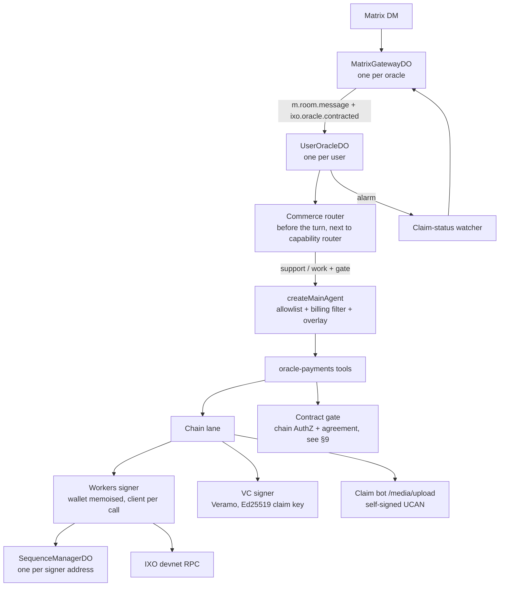

# Oracle Payments on the Workers Runtime — Design

**Status:** Implemented (2026-10-19) · **Date:** 2026-10-19
**Builds on:** `specs/matrix-agent-commerce.md` (the commerce lane as built on Node — read it first; this doc only covers what changes on Workers).
**Repos touched:** `ixo-oracles-boilerplate` only (`packages/oracle-runtime-workers`, `packages/oracles-chain-client`, `packages/common`, `apps/qiforge-workers-example`).

---

## 0. Implementation status

Built as `OraclePaymentsPlugin` in `packages/oracle-runtime-workers` (user docs: `packages/oracle-runtime-workers/docs/oracle-payments.md`). It was proven on devnet end to end through a real chat with a locally run Workers oracle (`apps/qiforge-workers-example/test/e2e-payments.ts`): support turn → `start_work` (escrow intent landed) → work turn → `deliver_work` (claim landed, `useIntent: true`, approval payment `GUARANTEED`).

Where the build differs from this design:

- **No VC wrap (§5.3 superseded).** Signing the claim body as a JSON-LD VC needs the oracle's Ed25519 private key in plugin code, and `ctx.ucan` deliberately never exposes it. eval-oracle's own `submit-claim` stores plain answers, and its pull lane accepts either. So the base-x alias and the ~1.25 MB VC bundle are not needed.
- **No support/work classifier.** A turn is in work mode when the buyer has an open job in `ctx.kv`, and in support mode otherwise. `start_work` is the deliberate transition. It is wired through a new generic plugin hook, `getTurnScope`.
- **Every client, not only Matrix.** The lane runs on portal, Matrix and channel turns. Component cards are not posted yet.
- **Claim bot uploads must send a `size` field** before the file. The bot otherwise guesses from Content-Length, and workerd's multipart encoding breaks the guess.

Found on devnet, outside this repo: **subscriptions-api cannot write agent agreements.** Its `callEngine` mints its decision-engine UCAN with the default `can: '*'`, which decision-engine refuses (401 → 502 → 500). So no subscriber can save an agreement through `PUT /api/v1/subscriptions/agent-agreements` today. The e2e therefore uses a buyer-owned collection (the gate's owner branch), where the owner writes the agreement to decision-engine directly.

## 1. Intent

We want to demo a **high-ticket service oracle** (≥ 500 USD per job) that runs on the **Cloudflare Workers runtime**. A user finds it in a Matrix DM, a free front desk explains what's on offer, the user contracts it, the oracle does the work, and it gets paid on IXO devnet: escrow intent → work claim → eval-engine approval → payout.

All of that already exists on the Node runtime (`packages/oracle-runtime/src/plugins/oracle-payments/`, about 40 files, tested). The Workers runtime has none of it. `core/main-agent.ts:123` explicitly lists "the commerce lane" as a branch Workers does not carry, and the runtime doesn't depend on `@ixo/oracles-chain-client` at all.

**eval-engine is retired.** Its two jobs in the commerce lane moved: claims are now judged by an **evaluation oracle** (the Agent Work oracle, `eval-oracle/examples/agent-work`) that asks **decision-engine** for the verdict and signs it on chain, and the buyer's agreement now lives in decision-engine's agreements registry. The Node plugin still calls eval-engine (`EVAL_ENGINE_URL`, `contract-record.service.ts`), so the Node lane is stale too, not just missing on Workers. §9 maps the replacement.

This doc is the port. The domain service the oracle sells (MRV plan design, due diligence, …) is a separate decision and is out of scope here. The port is service-agnostic: services come from the agent card.

## 2. Goals, non-goals, anti-goals

**Goals**

- The full paid loop from `matrix-agent-commerce.md` (Parts A + B) runs on `apps/qiforge-workers-example` against devnet: support/work routing, contract gate, `start_work` with escrow intent, `deliver_work` with a signed work claim, the claim-status watcher, and payout cards.
- Chain writes are signed **inside workerd**, with no Node sidecar.
- Behaviour matches Node: same tools, same gate reasons, same overlay text, same router engines (`llm` / `decision-shadow` / `decision`).

**Non-goals**

- Testnet/mainnet. This is devnet only for now.
- Any portal, eval-oracle or decision-engine change. Those are owned elsewhere (§9).
- Rewriting the Node plugin. It stays as is and keeps working.

**Anti-goals** (failure even if it "works")

- A second, divergent copy of the gate, router-mapping or claim-body logic. If Node and Workers disagree on who may be charged, that's a money bug.
- Any cached signing client, DO stub or fetch-bound object reused across requests. Cloudflare forbids it, and it fails in ways that only show up under load.
- Billable work starting without a passed gate and a landed intent. Routing failures must fall to _support_, never to _work_.

## 3. What is already proven

| Question                                                                                                                               | Evidence                                                                                                                                                                                                                                            | Result                                                                                                                                                                        |
| -------------------------------------------------------------------------------------------------------------------------------------- | --------------------------------------------------------------------------------------------------------------------------------------------------------------------------------------------------------------------------------------------------- | ----------------------------------------------------------------------------------------------------------------------------------------------------------------------------- |
| Can a Worker sign and broadcast IXO txs?                                                                                               | `decision-engine` signs `MsgExec{MsgSubmitClaim, MsgEvaluateClaim}` in production — `/Users/yousef/decision-engine/src/lib/ixo/chain.ts:328` (`getOracleSigner`), `chain-write.ts:211` (`feeChainFor`)                                              | **Yes**                                                                                                                                                                       |
| How is the account sequence kept safe across isolates?                                                                                 | `SequenceManagerDO` from `@ixo/impactxclient-sdk/cloudflare` (source: `ixofoundation/ixo-multiclient-sdk` `src/stargate_client/storeCloudflare.ts`). decision-engine re-exports it (`src/index.ts:9`) and binds it as `SEQUENCE_MANAGER`            | **Yes.** Our pinned SDK 3.0.0 ships the `./cloudflare` subpath                                                                                                                |
| Can the chain client's JSON-LD VC signing (`createCredential` + `verifyCredential`, used by `saveSignedClaimToMatrix`) run in workerd? | Spike, 2026-10-19: the built chain-client's own `createVeramoAgent('devnet')` + `createCredential` + `agent.verifyCredential`, run under `wrangler dev` (workerd, `nodejs_compat`, compat date 2026-07-15) with a devnet test account's Ed25519 key | **Yes, with one bundler alias** (§5.3). It signed `Ed25519Signature2018` and verified against the live devnet resolver, ~320 ms wall. The Node baseline gives the same result |

Not yet proven: a **deployed** Worker (CPU limits), and the workerd **vitest pool**. Only `wrangler dev` was run. See §10.

## 4. Architecture



The Node plugin already isolates everything effectful behind small injected interfaces: `ClaimChainClient { signAndSave, submit }`, `IntentChainClient { sendIntent }`, `EvaluationChainClient { getClaim }`, `ClaimBotUploader` (`claim-lane.ts`), the engagement state store, the event poster, and so on. **The port is mostly writing Workers implementations of those seams and re-hosting the Nest services as plain classes.** The business logic moves over unchanged.

## 5. The chain lane on Workers

### 5.1 Signer (copy the decision-engine pattern)

New module in `packages/oracle-runtime-workers` (suggested: `src/chain/`). It follows `decision-engine/src/lib/ixo/chain.ts` exactly:

1. **Protobufjs patch before the SDK loads.** workerd's `Buffer.prototype.utf8Write` mis-encodes strings of 40+ characters that end a message, and ixo addresses hit this. Apply `BufferWriter.prototype.string = Writer.prototype.string` (prototype-level, because the SDK's codegen calls `_m0.configure()` at import and resets statics), _then_ import the SDK.
2. **Dynamic, narrow SDK imports** (`@ixo/impactxclient-sdk/module/stargate_client/customClient.js`, `/cloudflare`, the claims + authz codegen modules), never the barrel. A static import would hoist above the patch, and the barrel defeats tree-shaking.
3. **Memoise only the wallet** (`DirectSecp256k1HdWallet.fromMnemonic(…, { prefix: 'ixo' })`, pure crypto) per isolate, keyed by mnemonic.
4. **Per call**, build a fresh signing client, `createSigningClient(rpc, wallet, false, { gasPrice: GasPrice.fromString('0.025uixo') }, createDOStoreFunctions(stub))`, with `stub = SEQUENCE_MANAGER.get(idFromName(address))`. Never cache the client or the stub.
5. **Sequence heal.** Wrap `signAndBroadcast` with decision-engine's `broadcastWithSequenceReset`: on an "ahead" mismatch, `POST /reset` on the DO; on "behind", wait one block (6 s) and rethrow.
6. Derive the address from the wallet up front. That removes the Node client's cold-start bug where `submitClaim` embeds an empty grantee (`claim-lane.ts:238`).

### 5.2 The three messages

These are the same messages `oracles-chain-client/src/client/claims/claims.ts` builds today. Each is wrapped in `MsgExec` with grantee = the oracle wallet:

| Lane                 | Inner msg                                                                                                                                   | Notes                                              |
| -------------------- | ------------------------------------------------------------------------------------------------------------------------------------------- | -------------------------------------------------- |
| `start_work` escrow  | `MsgClaimIntent { agentAddress, agentDid: did:ixo:<addr>, collectionId, amount }`                                                           |                                                    |
| `deliver_work` claim | `MsgSubmitClaim { adminAddress (collection admin from Blocksync), agentAddress, agentDid, claimId, collectionId, useIntent: true, amount }` |                                                    |
| claim status         | `getClaim(claimId)`                                                                                                                         | Read-only GraphQL. Fine on Workers already (fetch) |

**My call:** extract the msg builders into pure functions shared by both runtimes, rather than retyping them. Both runtimes then sign byte-identical messages. Where they live is left to the builder: `@ixo/oracles-chain-client` (new Workers-safe subpath), or `@ixo/common` alongside the Decision module, which is the precedent for "shared by both runtimes".

### 5.3 VC signing and the base-x alias

`saveSignedClaimToMatrix` signs the claim body as a JSON-LD VC with Veramo (`create-credentials.ts`) and then uploads it to the claim bot. The Veramo part runs in workerd as-is, provided the **host Worker's wrangler config** has:

```jsonc
// @digitalcredentials/ed25519-verification-key-2020's ESM build does
// `import * as baseX from 'base-x'` on a CommonJS module and then calls the
// namespace — invalid; Node only works because it loads the CJS `main`.
"alias": {
  "@digitalcredentials/ed25519-verification-key-2020":
    "<resolved path>/node_modules/@digitalcredentials/ed25519-verification-key-2020/dist/index.js"
}
```

Without the alias, the Worker fails at **startup** with `TypeError: baseX is not a function`, so every request breaks, not just claims. esbuild warns about it at build time (`call-import-namespace`). The hard-coded pnpm path is fragile, so the builder should pick a durable form. Options: a `pnpm patch` of that one ESM file (the repo already patches `@langchain/mcp-adapters`, see `pnpm-workspace.yaml`), or an alias the app resolves at build time. Either way, a CI build of the Workers app must fail if the fix is missing.

Other points:

- `createCredential` / `createVeramoAgent` are not on a chain-client export path today (`./credentials` doesn't export them; the spike deep-imported `dist/client/create-credentials.js`). Add an export.
- Bundle cost: the VC stack alone bundled to 6.4 MB raw / 1.25 MB gzip. That fits the paid-plan Worker limit, but measure the whole app once the SDK is in (§10).
- Skip `setupClaimSigningMnemonics` on Workers. The Ed25519 claim key is already resolved by `UserOracleDO.resolveSigningMnemonic()` (`ORACLE_SIGNING_MNEMONIC`, else the account room through the gateway). Pass it as `decryptedSigningMnemonic`, the parameter Node already supports.
- The `@context` with inline `@vocab` must stay as is (`claims.ts:146`). Safe-mode JSON-LD throws without it.

### 5.4 Saving the claim body (the bot calls)

The claim body is saved before `MsgSubmitClaim`, and the bot's answer _is_ the claim id. If this step is wrong, the claim lands on chain but the engine can't read its body, so there is no approval and no payout.

Node's `saveSignedClaimToMatrix` (`oracles-chain-client/src/client/claims/claims.ts:134-227`, via `matrix-bot/matrix-bot.service.ts:134-175`) makes three bot calls after signing the VC. All three are kept on Workers, in this order:

1. **Rooms bot** `room.v1beta1.sourceRoomAndJoin(oracleDid)` finds or creates the oracle entity's room. Capability: `{ with: 'ixo:matrix-rooms-bot', can: '*' }`.
2. **Claim bot** `bot.v1beta1.invite(roomId)` invites the claim bot into that room. Capability: `{ with: 'ixo:matrix-claims-bot', can: '*' }`.
3. **Claim bot** `claim.v1beta1.saveClaim(collectionId, { ...claim.body, credentials: vc })` saves the body and returns `{ data: { cid } }`. That cid is the `claimId` in `MsgSubmitClaim`.

Deliverable files use a separate call on the same bot, `POST {claimBot}/media/upload` (`claim-lane.ts:191`).

**Which bot host:** whichever one the **reader** uses. The Agent Work eval-oracle resolves `claim.bot.<domain of the collection entity's MatrixHomeServer service>`, falling back to the network default (`eval-oracle/packages/eval-oracle/src/lib/ixo/claim-bot.ts:51`). Node always uses the network default (`matrix-bot/config.ts:46`, `claim.bot.devmx.ixo.earth`). The two agree only while the entity lives on the default homeserver, so the Workers lane must resolve the host the way the engine does. _(My call: the reader is the authority.)_ Rooms-bot calls follow the same rule.

**Not affected by the 2026-10-15 Vault move.** That move covers public linked-resource documents (`#acard`, `#pro`, …). Claim bodies still go to the claim bot, encrypted per collection.

**Auth** for all bot calls uses the existing `ctx.ucan.mintSelfSignedInvocation(serviceUrl, capability)`. No new minting code. Whether `@ixo/matrixclient-sdk` (the typed client Node uses) bundles cleanly in workerd hasn't been checked. If it doesn't, call the same endpoints with `fetch`, as `claim-lane.ts:191` already does for uploads.

## 6. Re-hosting the plugin

| Node piece                                                                                                                                                                      | Node dependency                                         | Workers host                                                                                                                                                                                    |
| ------------------------------------------------------------------------------------------------------------------------------------------------------------------------------- | ------------------------------------------------------- | ----------------------------------------------------------------------------------------------------------------------------------------------------------------------------------------------- |
| `types`, `util`, `commerce-route.decision`, gate logic in `contract-gate.service`, `work-intent.service` logic, `work-summary-extractor`, `commerce-overlay` text, tool schemas | none, or Nest DI only                                   | **Shared, pure.** Strip the `@Injectable` wrappers and keep one implementation (see anti-goals)                                                                                                 |
| `agent-card.service`                                                                                                                                                            | `IXO.entities.getEntityById` (Blocksync GraphQL), fetch | Fetch-only, so it ports directly. TTL cache in DO memory                                                                                                                                        |
| `local-card`                                                                                                                                                                    | `node:fs`                                               | Card JSON from an env var or a bundled import (no filesystem on Workers). Same zod validation                                                                                                   |
| `active-engagement-cache`                                                                                                                                                       | Redis / in-memory                                       | `UserOracleDO` storage. The cache is per user, and so is the DO                                                                                                                                 |
| `engagement.service` (901 lines)                                                                                                                                                | `MatrixManager.stateManager`                            | The gateway's existing `getRoomStateEvent` / `sendStateEvent` (`do/contracts.ts:816-829`). Same `work_engagement.<thread>` state keys, so the two runtimes read each other's state              |
| `claim-status.watcher`                                                                                                                                                          | `@nestjs/schedule` cron                                 | DO alarm on the `UserOracleDO` that owns the engagement, or the runtime's tasks scheduler (`src/tasks/scheduler.ts`). Builder's choice                                                          |
| `contracted-event.listener`                                                                                                                                                     | Matrix timeline listener                                | **Gateway gap:** `MatrixGatewayDO` ingests only `m.room.message` (and membership). It must forward `ixo.oracle.contracted` to the user DO as a cache-bust. The event stays untrusted (spec §10) |
| `work-claim.service` delivery file → room                                                                                                                                       | `matrix/room-file.js`                                   | **Gateway gap:** there is no general "upload a file into this room" method (only `uploadUserSnapshotStream`). Add one, encrypting for E2EE rooms like the snapshot path does                    |
| `thread-attachments.service`                                                                                                                                                    | sandbox bridge, attachment archive                      | Workers already has `src/attachments` and a sandbox plugin; wire to those                                                                                                                       |
| Component cards (`ixo.oracle.component`, `work_status`)                                                                                                                         | `sendMatrixEvent`                                       | `ctx.matrix.postEvent`, which already exists                                                                                                                                                    |
| Router (`message-router.service.ts`) + allowlist/billing/overlay (`graph/main-agent.ts:208-266`)                                                                                | Node messages module                                    | In `UserOracleDO`'s turn path next to the capability router (`do/user-oracle-do.ts:3977`), and in Workers `createMainAgent`. Same single guard: `client === 'matrix' && commerce`               |

## 7. Config and secrets

New for the Workers app (all devnet). Read by the plugin's `configSchema` unless noted:

| Key                                | What                                                                                                                                                                                           | Kind          |
| ---------------------------------- | ---------------------------------------------------------------------------------------------------------------------------------------------------------------------------------------------- | ------------- |
| `ORACLE_SECP_MNEMONIC`             | The oracle's secp256k1 wallet (the AuthZ grantee that signs intents and claims). Node calls it `SECP_MNEMONIC`; the Workers base schema deliberately omits that. Name to match decision-engine | secret        |
| `CHAIN_RPC_URL`                    | IXO devnet RPC                                                                                                                                                                                 | var           |
| `PORTAL_URL`, `ORACLE_PAYMENTS_*`  | As on Node. `EVAL_ENGINE_URL` is dropped (§9)                                                                                                                                                  | vars          |
| Agent card                         | Replaces `AGENT_CARD_PATH`: inline JSON or bundled file                                                                                                                                        | var or bundle |
| `IXO_CLIENT_SEQUENCE_MIN_DELAY_MS` | Read by `SequenceManagerDO` itself (decision-engine uses `1000`)                                                                                                                               | var           |
| `SEQUENCE_MANAGER`                 | DO binding, `class_name: SequenceManagerDO`, new migration tag with `new_sqlite_classes`                                                                                                       | binding       |

The Ed25519 claim key needs nothing new: `ORACLE_SIGNING_MNEMONIC` or the account room. When this moves to testnet/mainnet, every secret created goes to `~/.ixo/<service>-<network>-keys.json` per the global rule.

## 8. Decided

**By the owner (2026-10-19):**

- The demo runs as a **new devnet oracle entity** on `devmx.ixo.earth`, with its own secp wallet, `#acard`, and its own Worker scripts. The existing "Mike Matrix Test" Workers deploy is not touched.
- **Workers-only wallet.** No Node deployment ever signs with it. So `SequenceManagerDO` alone keeps the sequence safe, one claim-status watcher owns the payout cards, and Node↔Workers engagement-state compatibility is nice to have, not a requirement.

**Carried over from the Node spec:**

Thread-per-request, sticky engagements, support-mode hard allowlist keyed by contributing plugin name, `0.6` routing floor, fail-open to support, gate answers cached ~60 s (never failures), one active intent per (agent, user), `resultStatus` passed through verbatim. None of these are revisited by the port.

## 9. External prerequisites (not in this repo)

- **Who evaluates and pays (replaces eval-engine).** The **Agent Work evaluation oracle** (`/Users/yousef/eval-oracle/examples/agent-work`, on `@ixo/eval-oracle`) pulls claims from the agent collections it's hired for and produces facts: service in agreement, amount within agreement, `#acard` unchanged, honesty, five scores. Its speed score reads **our `MsgClaimIntent`**, so intents must be filed through `MsgExec` exactly as §5.2 does. **decision-engine** decides, and the evaluation oracle signs `MsgEvaluateClaim`, which releases our escrow. For the demo, that oracle must be deployed on devnet and hold `EvaluateClaimAuthorization` on the user's agent collection. Not verified.
- **The contract gate (replaces `for-oracle`). Decided: chain grants + the agent's own agreement.** No decision-engine change is needed. Two reads, both by the service oracle as itself:
  1. **Chain.** `granteeGrants(oracle wallet address)` gives each `SubmitClaimAuthorization` grant's collection id, quota, `maxAmount` and intent window. For each grant, take the collection's entity and compare its owner to the Matrix sender's DID. This answers "contracted?", "quota left?" and "price ≤ `maxAmount`?" (`max_amount_too_low`).
  2. **decision-engine agreement self-read.** Call `GET https://decision-engine.devnet.ixo.earth/v1/collections/:collectionId/agreements?counterparty=<oracle wallet address>` with a self-signed UCAN invocation: `{ with: 'ixo:eval-engine', can: 'agreement/read' }`, audience `did:web:decision-engine.devnet.ixo.earth`. The resource string is still `ixo:eval-engine` in decision-engine; that's its name, not a typo. The engine admits the caller when `principal.address == counterparty`. This is on decision-engine `main` since `a8e4c18` (2026-09-13), in `assertAgreementReadable` (`src/routes/v1/collections.ts`). Note that decision-engine's own `docs/features/agreements.md` still says owner-or-evaluator only, which is out of date. The self-read is fallback-free (`agreementFor`), so it only ever returns the row written for **this** counterparty, never the whole-collection terms, and `404` means no agreement. The `agent-services/v1` doc's `services[]` / `priceUsd` answer "which service, at what price". These are the same fields the Agent Work evaluator gates on, so the oracle refuses before work starts, for the same reasons the evaluator would reject afterwards.
  - **Requirement:** the principal's address must equal the claim's `agentAddress`, i.e. the oracle DID must be `did:ixo:<secp wallet address>` with the Ed25519 claim key as a verification method on it. That's the Node convention (`agentDid: did:ixo:${address}`). The new devnet entity must be set up this way.
  - **Not yet verified:** a real signed self-read against devnet. An unauthenticated call returns `401`, so the route is live. Who writes the per-counterparty agreement at contract time (the portal's contract flow, presumably) also isn't confirmed. The first build step is a signed probe that expects `404` (route present, no agreement) rather than `403`.
- **Portal §8.** Component-card renderer, `GRANT_ORACLE` preselection, posting `ixo.oracle.contracted`, thread UX. If these aren't live, the demo can contract via `/connect`, but the in-chat cards won't render.
- **Devnet setup.** An oracle entity with an anchored `#acard`, a funded oracle wallet (gas), and a test user with a funded subscription and an AuthZ grant whose `maxAmount` covers the ≥ 500 USD price (otherwise you get `max_amount_too_low`). The `ixo-test-account` skill covers the user side.

## 10. Verification

1. Unit tests in the Workers vitest pool for the signer (patch applied before import, wallet memoised, client not), the sequence heal, the msg builders (byte-equal to Node's), and each re-hosted service through its existing seam fakes. Reuse the Node plugin's fixtures (`__test-fixtures__/`).
2. A startup smoke test that the bundled app boots (catches the base-x regression).
3. Run the VC spike's checks inside the workerd vitest pool as well as `wrangler dev`, since the two can differ.
4. A deployed devnet Worker: measure CPU per `deliver_work` (JSON-LD canonicalisation is CPU-heavy; 107 ms wall locally) and the final gzip bundle size.
5. End-to-end on devnet, on the deployed Worker: ask → support answers price → `show_contract` → contract → `start_work` (intent lands, escrow visible on chain) → `deliver_work` (file in room, claim lands) → the Agent Work oracle approves via decision-engine → payout card.

## 11. Left to the builder

- Where the shared pure logic lives (chain-client subpath vs `@ixo/common`), as long as there's exactly one copy.
- The durable form of the base-x fix.
- Watcher on DO alarm vs the tasks scheduler.
- Card source format on Workers (inline var vs bundled JSON).
- Explicit fee after simulate (decision-engine) vs `"auto"` (Node today).
- **In-process vs a separate signer Worker.** _My call:_ start with the chain lane inside the user-object script. If the measured bundle size or isolate memory (§10.4) doesn't fit, which is plausible since every user DO shares one 128 MB isolate, move the chain lane unchanged into its own Worker. That Worker holds the `SEQUENCE_MANAGER` binding and is reached by service binding. It is still workerd, not a Node sidecar, so the "sign inside workerd" goal holds either way.
